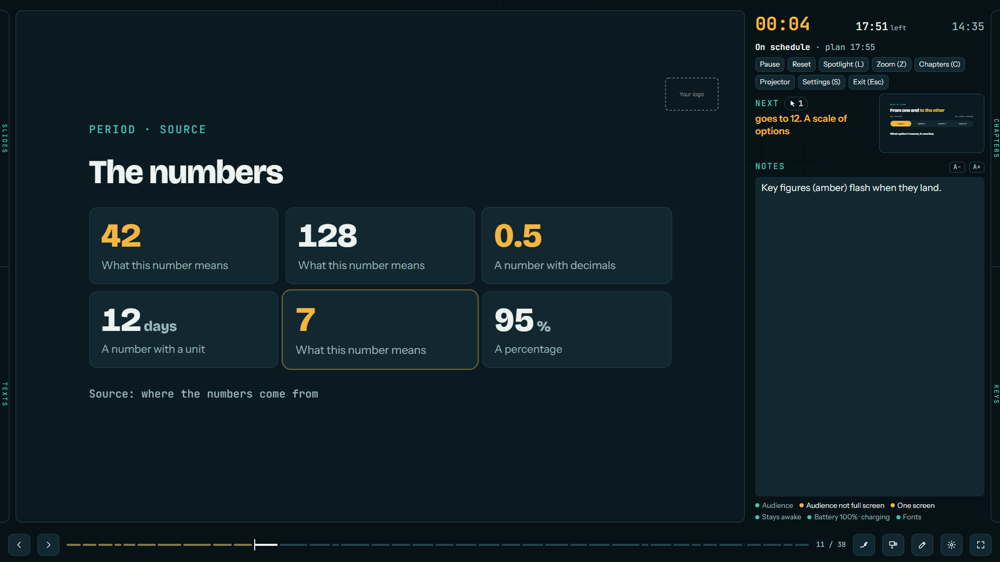

# HTML presentation creator

**One HTML file** that is a complete presentation tool: 38 animated template slides, a presenter view and an editor.
No installation, no internet, no PowerPoint.

## Start

**Try it online:** [open the presentation](https://belgian-coder.github.io/Html-presentation-creator/Presentation.html) (Chrome or Edge).

To make your own:

1. Download **[Presentation.html](Presentation.html)** (on GitHub: *Download raw file*).
2. Open it in **Chrome or Edge**.
3. Press **E** to edit. **Ctrl+S** saves into the same file.
4. Press **F** for full screen and present with the arrow keys or a clicker.

Everything is inside that one file. Make a copy for each talk.

## Edit

Type on the slides, add slides from ready-made layouts, insert pictures, video, charts and shapes, and animate
anything on a timeline.

## Present

Press **P** for the presenter view: current and next slide, notes, timer and time plan. The audience sees only the
slides, on the second screen.

| Key | Does |
|---|---|
| → / ← or a clicker | next / back |
| F | full screen |
| P | presenter view |
| E | editor |
| S | settings: theme, time per slide, print, export |
| L, Z | spotlight, zoom |
| D, H | pen, highlighter |
| B | black screen |

Ten themes, each with its own colours and fonts. Print the slides or a handout with notes, or save them as PDF.

**More:** the [guide](docs/GUIDE.md) shows every feature with pictures.

## For AI assistants

A skill lets Claude, Codex or GitHub Copilot change a presentation for you: translate it, add slides, fix notes.
It is in [`.claude/skills/animated-presentation`](.claude/skills/animated-presentation/SKILL.md); Codex finds it
through [`.agents/skills`](.agents/skills/animated-presentation/SKILL.md). Coding agents read [AGENTS.md](AGENTS.md).
