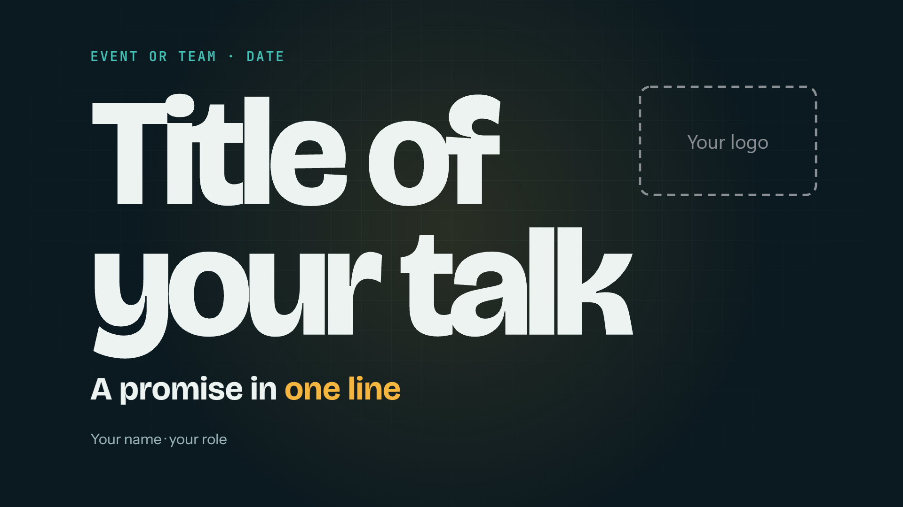
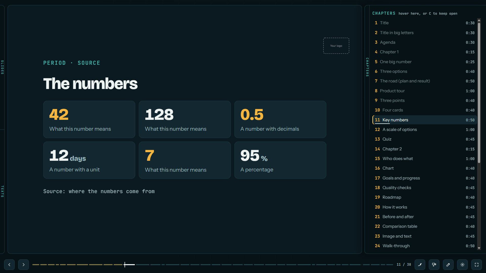
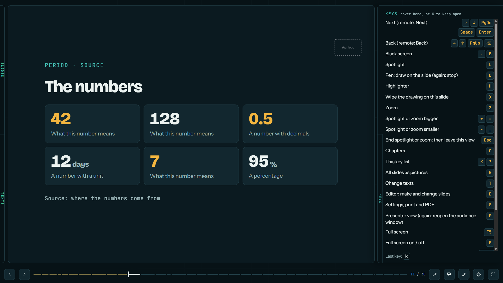
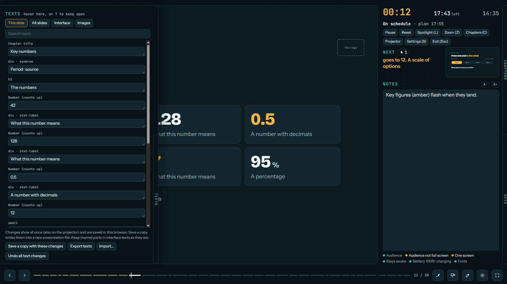
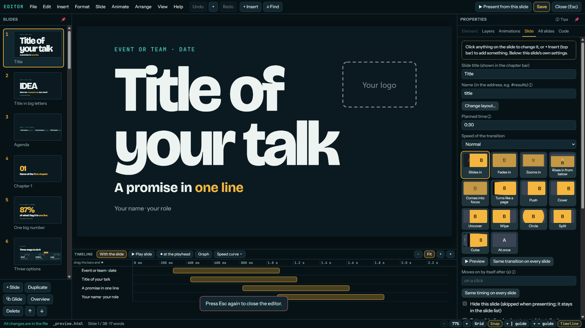
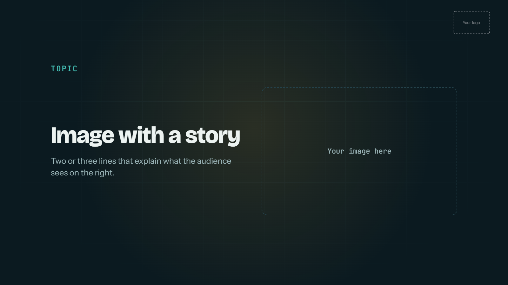
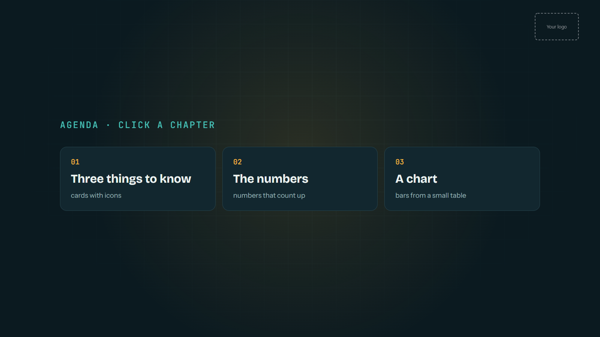

# Animated presentation

An animated 38-slide presentation in **one HTML file**, built to be used as a template: the slides hold placeholder texts and pictures that you replace with your own. It needs no installation and no internet, and it works with a presenter clicker. It has a PowerPoint-style presenter view with checks before you start, themes, a time plan per slide that you can export and import together with the realized times, backup slides for questions, and a text editor so you can change the wording without touching the code. It also contains slide templates for new slides, including a clickable agenda, charts, a QR code, a video, a break timer and click effects, and slides can glide from one to the next (morph).

**It is also its own editor.** Press **E** in the file to add, change and reorder slides, type texts on the slide, insert blocks, set animations with keyframes and place things freely, then save straight into the same HTML file (Chrome or Edge). No installation, no server, no build step. See *Part 1: The editor*.



---

## Part 1: Using the presentation

### Start
1. Copy `Presentation.html` to the laptop. It is the only file you need.
2. Open it in **Chrome or Edge**: double-click it, or drag it into the browser.
3. Press **F** (or **F5**) for full screen.

Nothing has to be installed. The fonts and images are inside the file.

### Keys and clicker

| Action | Keys |
|---|---|
| Next (animation step or slide) | → ↓ PageDown Space Enter, or the clicker's *Next* button |
| Back | ← ↑ PageUp Backspace, or the clicker's *Back* button |
| First / last slide | Home / End |
| Full screen | F or F5 |
| Black screen (press again or Next to come back) | B or `.` |
| Presenter view | P |
| Spotlight: darkens everything except a circle around the mouse | L |
| Pen: draw on the slide with the mouse (again: off; also the ✎ button on the bar) | D |
| Highlighter | H |
| Wipe the drawing on this slide | X |
| Zoom: magnifies the slide around the mouse | Z |
| Spotlight or zoom bigger / smaller (or the mouse wheel) | + / − |
| Presenter view: keep the chapter list open (press again to close) | C |
| Presenter view: keep the key list open (press again to close) | K or ? |
| Presenter view: keep the Slides drawer open (all slides as pictures) | G |
| Presenter view: keep the Texts drawer open (change texts) | T |
| End spotlight and zoom, then close the presenter view | Esc |
| Settings: theme, colours, time per slide, export and import, print / PDF | S, or the gear button |
| Editor: make and change the presentation (see *The editor*) | E, or the pencil button |
| Animations on/off (only when Windows has animations turned off) | M |

The bar at the bottom shows one segment per slide. Hover over a segment to see the chapter title, and click it to jump there. The bar hides when the mouse is still and comes back when you move the mouse near the bottom.

Some slides use extra clicks before they move on:

| Slide | What Next does |
|---|---|
| 7 · Road (`timeline`) | 1st click starts the car (it also starts by itself after 2 s). A click during the drive plays the rest faster. The next click moves on. |
| 8 · Product tour (`product`) | Each click shows the next screen (the tabs above the picture work too). |
| 12 · Spectrum (`mindset`) | 4 clicks walk through the modes. |
| 15 · Swimlanes (`flow`) | A click while the dot still moves shows the end at once. |

Back always shows the previous slide in its **finished** state, so no animation replays when you go back.

### Pen and highlighter

- **D** (or the ✎ button on the bar) turns the pen on, **H** the highlighter: draw on the slide with the mouse, a pen or a finger. Esc stops drawing; **X** wipes the lines on this slide.
- The lines belong to the slide: back on it, they are there again. Both windows show them (the audience sees what you draw in the presenter view). They are never saved in the file.

### Spotlight and zoom

- **L** turns the spotlight on: the slide goes dark except for a circle that follows the mouse.
- **Z** zooms the slide in around the mouse; move the mouse to look around.
- The **mouse wheel**, or the **+** and **−** keys, make the circle or the zoom bigger or smaller.
- **Esc** turns both off. A new slide ends the zoom; the spotlight stays on until you turn it off.
- In **Settings → Spotlight** you choose the circle size it starts with (in % of the slide height) and how dark everything outside the circle is (in %). This browser remembers both; **Reset spotlight** goes back to the file's values (20 % and 78 %, follow mode off). **Save a copy with these settings** writes them into the copy.
- **Show the spotlight by itself while the mouse moves** (also in Settings): the spotlight appears as soon as the mouse moves over the slide and fades out 1.5 s after it stops, like the effect of the Logitech software. **L** still turns it on for good, and **Esc** still leaves the presenter view at once. While you zoom (Z) it stays out of the way.
  - It reacts to the mouse over the large slide in the presenter view (or over the whole window when you present without the presenter view), not over the audience window on the projector. With two screens, keep the mouse on the presenter screen; the projector shows the same circle.

#### Logitech Spotlight (or another remote) without its software

- **Next** and **Back** work as they are: the remote sends PageDown / PageUp or the arrow keys, and the deck listens to all of them.
- What the **top (highlight) button** does without the Logitech software depends on the model, and Logitech does not document it clearly. Open the presenter view, hover over the **Keys** tab and press the button: the bottom line, *Last key*, shows what the remote sent.
  - If the button moves the mouse pointer when you hold it, switch on *Show the spotlight by itself while the mouse moves*. Holding the button then gives a spotlight that follows the remote, and letting go hides it.
  - If it sends a key, add that key to `spotlight` in `KEYS` (`src/js/08-controls-and-input.js`, *Keyboard and presenter remotes*) to turn the spotlight on and off with it.

In the presenter view, use the keys or the **Spotlight** and **Zoom** buttons, and move the mouse over the large slide on the left. The audience screen shows the same circle or zoom at the same spot.

| Spotlight | Zoom |
|---|---|
|  |  |


### Presenter view (two screens)

1. Connect the projector and set Windows to **Extend** these displays (Windows key + P).
2. Open the file and press **P**. A second window opens; this is the **audience view**.
3. Drag the audience window to the projector, or click **Move to projector** (Chrome/Edge ask permission once). Click inside it and press **F**.
4. Present from the presenter window. The audience window follows every click.







The presenter view shows:
- **Timer, countdown and clock.** On the first slide the timer waits for your first Next. Click the timer or **Pause** to pause it; **Reset** starts it again from the current slide.
  - The **countdown** next to the timer shows the planned time left: the total of the time plan minus the timer, for example *09:32 left*. It counts from the slide where the timer started, so with the usual start on slide 1 it leaves out the opening slide (the timer starts with your first Next).
  - Past zero it turns rose and counts the overtime, for example *+00:40 over*.
  - The **clock** on the right always shows the time of day in 24-hour notation (*14:05*), whatever the computer's language settings.
- **Pace line**, for example *≈ 30 s ahead · plan 10:35*. It is teal when you are ahead, white when you are on schedule (within 15 s), amber when you are behind, and rose when you are more than a minute behind. If you open the presenter view on slide 1, the timer starts with your first Next and the plan total leaves out the opening slide. If you open it on a later slide, the timer and the plan start at that slide. If you go Back to show something again, the pace is still measured against the furthest slide you reached.
- **Buttons:** Pause, Reset, Spotlight (L), Zoom (Z), Chapters (C), Projector, Settings (S) and Exit (Esc). All keys are in the **Keys** drawer.
- **Next:** what the next click does, next to a small preview of the next slide. The pointer badge after "Next" counts the clicks left before the slide changes (orange when there is more than one). The current slide's number is in the bottom bar.
- **Notes:** your speaker notes for this slide, in all the room that is left (see *Speaker notes* in Part 2). On slides with clicks, the line for the current click lights up and scrolls into view. **A−** and **A+** change the text size; this browser remembers it.
- **Keys:** a second drawer under the Chapters tab, at the lower half of the right edge. It lists every key and what it does, in large type (generated from `KEYS` in JS section 9 and `KEY_HELP` in JS section 11; the texts are the `keys.…` interface texts), and at the bottom the last key that was pressed (handy to see what a remote sends). Hover over the *Keys* tab, or press **K** to keep it open.
- **Checks:** a row of small dots at the bottom of the side panel (see *Checks before and during the talk* below).
- **Slides:** a drawer at the upper half of the **left** edge. It shows every slide as a small picture in its final state; click one to go there (the drawer then closes). Hover over the *Slides* tab, or press **G** to keep it open. Backup slides have their own heading at the end.
- **Texts:** a drawer at the lower half of the left edge, to change the wording of the slides and of the interface (see *Change texts* below). Hover over the *Texts* tab, or press **T** to keep it open.
- **Chapters:** hidden in a drawer at the right edge of the window; only a thin *Chapters* tab shows. Move the mouse onto that tab and the list slides in; move away and it hides again. Press **C** (or the **Chapters** button) to keep it open. Click a chapter to jump there; the drawer then closes. Each row shows the planned time. Once a slide is done, its row shows the time it really took, in **teal** (on time) or **rose** (more than 10 s longer than planned). Under the current row, a thin line fills up as you use the slide's time.
- **Bottom bar:** each segment is as wide as the slide's planned time. Finished slides are teal or rose. The **white marker** shows where the plan says you should be now. Compare it with the furthest slide you reached with Next: marker further right means you are behind, further left means you are ahead.

The pace counts the furthest slide you reached with **Next**. A jump ahead (chapter click or End) counts while you stay on that slide, and becomes permanent once you continue from there with Next. Checking a later slide and coming back therefore does not make you look ahead. Going Back keeps the real times and colours of the slides you already showed.

If the audience window was closed, press **P** again (or the **Open** button in the check row) to reopen it.

#### Checks before and during the talk

The bottom of the side panel shows a row of checks. Each has a coloured dot: **teal** is fine, **amber** is worth a look, **rose** is a problem. Hover over a check for advice. The checks only inform you: they never stop or block anything.

| Check | What it tells you |
|---|---|
| **Audience** | The audience window answers every second and shows the same slide. **Audience window closed** has an **Open** button; **Audience not responding** (it froze, or shows another page) has a **Reconnect** button; **Audience on another slide** has a **Resync** button that brings it back to your slide. |
| **Full screen** | Whether the audience window fills its screen. If not: click it and press F. |
| **Projector / One screen** | Whether Windows sees a second screen (Chrome and Edge only). |
| **Stays awake** | Whether the browser keeps the screen from dimming or locking. |
| **Battery** | The battery level, and whether the power cable is plugged in (rose below 40 % without a cable). Only where the browser reports it. |
| **Fonts** | Whether the fonts of the presentation are loaded. |
| **Animations off (M)** | Shown when Windows asks for less animation. |
| **Script error** | Shown when a slide's script failed. The slides keep working: Next and Back always go on, and the error is counted here (details in the browser console, F12). The audience never sees a message. |


### Backup slides

Backup slides are extra slides for questions. They come after the last slide of the talk, but **Next never goes there**, they have no segment in the bottom bar, and they are not part of the time plan.

- Open one with the **Slides** drawer (G) or the chapter list, both under the heading *Backup slides*, or with its name in the address (`#name`).
- On a backup slide, the bottom bar shows *Backup 1 / 2*. Next and Back move between the backup slides; **Back on the first backup slide returns to the slide you came from**.
- To make a slide a backup slide, add `data-backup` to its `<section>` (see *Add a slide* in Part 2). The slide templates contain an example: `template-backup`.

### Change texts (Texts drawer)

In the presenter view, hover over the **Texts** tab at the lower half of the left edge, or press **T**.



- **This slide** lists every text of the slide on screen: the chapter title, the titles and texts, numbers that count up, the texts of click steps (slide 12), and the speaker notes. It follows the slide while you click through.
- **All slides** lists every slide text in one list, slide by slide. The search field filters it.
- **Interface** lists every text of the interface: buttons, messages, help texts, the key list. Use it to adapt or translate the interface. Keep parts in braces such as `{count}` as they are: the presentation fills them in.

Type in a field: the slide changes at once, also on the projector. The text you are editing gets a dashed outline on the large slide. A changed text gets an amber line; **↺** puts the original text back. A number that counts up only accepts a number (for example `52.5`).

While a field has the keyboard, keys type into it: B, L, Space and the arrow keys do not change the slides. **Esc** leaves the field. A remote's **PageDown / PageUp** still leaves the field and changes the slide, so the talk never gets stuck.

Changes are saved **in this browser** at once, like the other settings, and reach the audience window too. To keep them in the file:
- **Save a copy with these changes** (in the drawer, or *Save a copy with these settings* in the settings panel) writes the changed texts into a new presentation file, together with the theme and time plan.
- **Export texts** saves every text (slide texts and interface texts) as one JSON file; **Import…** reads such a file back. A slide text whose original was changed in the file since is skipped, never put on the wrong place.
- **Undo all text changes** goes back to the texts in the file (asks first).

### The editor (E)

Press **E** (or click the pencil button in the bottom bar) to edit the presentation in the file itself. Everything happens in the browser: no installation, no server, no `build.py`.



**The screen** works like a desktop program: a menu bar at the top, the slide in the middle, the slides and the panel at the sides (they hide to a tab at the edge), a status bar at the bottom.
- **Menu bar: File, Edit, Insert, Format, Slide, Animate, Arrange, View, Help.** *Format* has the text styles, Bold / Accent and Copy / Paste style; *Animate* the quick animations, Draw a motion path, Morph pairing, Copy / Paste appearance, Play slide and Record. Every action is there with its key (✓ for switches such as Grid and Snap); an action that needs a selection is greyed and says why. Click a menu, then move the pointer to the others. With the keys: **Alt** (alone) or **F10**, then ← → between the menus, ↓ opens one, ↑ ↓ through it, Enter does it, Esc back. Next to it: Undo / ▾ / Redo, **+ Insert**, **⌕ Find**, Play, Save and Close.
- **Docks that hide.** The slide list (left) and the panel with its tabs (right) hide to a tab at the edge of the window, so the slide gets the room. The pointer on the tab opens it (after a moment); it closes again shortly after the pointer leaves (not while you type in it), or with a click on the slide. **📌** in its header keeps it open (remembered in this browser for every presentation; View › Pin also does it).
- **Status bar** (bottom): saved or not, the file name, *slide n / m*, the selected element with its place, size and angle, and the zoom, Grid and Snap.
- **Left: the slides.** Click one to edit it. Drag a slide to another place, or use ↑ ↓. **+ Slide** opens the layouts (an empty slide or any slide template); **Duplicate** and **Delete** do what they say. **Overview** (or **O**) shows every slide large in one window: click one to open it, drag one to another place to move it (also into a gap; a drop after the last picture puts it at the end; Undo takes it back, also while the overview is open).
- **Middle: the slide.** Click a text and type; **Enter** finishes it, **Shift+Enter** starts a new line. Click any element (a card, an image, a list, a chart) to select it: an amber outline shows what is selected. **Zoom** with **− / +** in the status bar (the percentage is the size on screen; click it to fit the slide again), Ctrl+wheel or Ctrl+plus / minus, Ctrl+0 fits it again; a zoomed slide scrolls (wheel, Shift+wheel sideways, or hold **Space** and drag, or drag with the middle mouse button).
- **Right: five tabs.**
  - **Element**: the settings of the selected element (see below).
  - **Layers**: every element of the slide as a tree, in the order of the file (a later one lies on top; freely placed ones lie above the rest, and *To the front / To the back* change that). Click a row to select that element, Shift+click to add it to the selection or take it out again, **double-click** to give it a name (Enter keeps it, Esc cancels, empty removes it: `data-editor-name="Logo box"`, shown in quotes in the Layers and Animations tabs, only for the editor; also the *Name* field in the Element tab); the pointer over a row outlines the element on the slide. The field above the list finds elements: only rows whose name or text (all of it, not only the shown start) has the typed letters stay, with the blocks that hold them; it stays set for other slides until you clear it. **👁** hides an element while you edit (to reach what lies under it); **🔒** locks it: it takes no clicks (a click goes to what is under it), cannot be dragged, moved (arrows, Ctrl+↑ / ↓, the X / Y / width / height fields, *Place freely*, front / back), cut or deleted, also not by deleting the block that holds it, and its outline is dashed. It does go along when the block that holds it is moved. Nothing new (paste, insert, duplicate) goes inside a locked block: unlock it first. Its text and style can still be changed. Unlock it in this tab. Both are kept in the file (`data-editor-hidden`, `data-editor-locked`); presenting ignores them. A copy (duplicate, paste, Ctrl+drag) starts unlocked and visible.
  - **Animations**: everything on the slide that appears or moves, in playing order: *with the slide* (by order) and *on click 1, 2, …*. Change an order or a click number right there, click a name to select that element. A small timeline under every row shows when it starts and how long it moves (hover it for the milliseconds, taken from the slide's own CSS; a striped bar loops). **Drag a bar** left or right to make it come earlier or later: *with the slide* it changes the element's order (one step of the pace at a time); for an element with its own animation (used by no other element) it changes that animation's delay in steps of 50 ms, also on a click. Undo takes it back. **▶ Play slide** plays the slide on the canvas as in the presentation (rise-ins, animations, numbers counting up); **Next click ▶** plays each click; **■ Stop** or Esc shows the still slide again.

    **Quick animations** (top of the tab, for the selected element): *In* (Fade, Rise, Pop, Zoom, From left, From right, Blur, Bounce, Drop in from above, Roll in, Stretch in), *In* also **Lands** (comes down onto the slide from big), *Emphasis* also Nod, Spin round, **Bounces** (jumps and settles, on a click), **Orbit** (a small circle around its place, over and over), **Rock** (tilts to and fro) and **Blink** (fades a little and back); **Recent** (the top row, once you have used some): the quick animations you gave last, newest first, in this browser for every presentation, *Out* also Rise away, Spin away, **Falls away** (drops off, tipping over) and **Pops away** (swells, then shrinks to nothing), *In* also has **Grow →** (grows out of its left side), **Unfold** (folds open from its top) and **Swing in**; *Emphasis* (Pulse, Float, Shake, Wobble, Jelly: squash and stretch, **Swing**: hanging from its top, **Flash**: lights up twice, **Heartbeat**, **Tada!** on a click, **Glow**) and *Out* (Fade out, Sink, Zoom out, To the left, To the right, Blur away, Shrink away: on a click). The pointer over one plays it on the element; a click gives the element that animation (a ready-made one you can change afterwards: keyframes, easing). *No animation of its own* goes back to the usual rise-in. **Turns and grows from** (with the keyframes): the corner, edge or middle the animation turns around and grows from (Grow → grows out of its left side, Swing hangs from its top); in the file `"origin": "left top"`. Only the animation turns there; the element's own rotation keeps its middle, so it never moves on the slide. Besides opacity, x, y, scale, rotate and blur a keyframe can **stretch** (*Width ×*, *Height ×*: times the scale, for squash and stretch) and **slant** (*Slant*, degrees), **brightness** (*Brightness ×*: 2 = twice as bright) and **hue** (*Hue*, degrees: a colour shift around the colour wheel): pick them in **+ property** under the keyframe table (or in the timeline); their columns show once an animation uses them.

    **The timeline** (the animation panel along the bottom, under the slide; **T** or View › Timeline shows or hides it, the status bar too; drag its top edge to make it higher): one row per element that appears or moves, for one part of the slide at a time (*With the slide*, *Click 1*, *Click 2* …, buttons at the top). A bar runs from when it starts to when it has finished.
    - **Drag a bar** later or earlier: an element with an animation of its own changes its delay (in steps of 10 ms); one that rises in with the slide changes its order. It **pulls** to the starts and ends of the other bars and to the red line (Alt: no pull, 1 ms steps); a label shows the time while you drag.
    - **The left end** of a bar changes when it starts (its end stays); **the right end** how long it takes (its own animation: the duration; otherwise its Speed, written as `animation-duration: 650ms`).
    - **Keyframes (◆)** of its own animation sit on the bar: drag one to another moment (the first and last: the start and the end), click one to select it and press Delete to remove it, double-click the bar for a new keyframe there (with the values the element shows at that moment). **◆ at the playhead** adds one at the red line for the selected element. The line between two ◆: click it for the easing window.
    - **Several keyframes at once**: Shift+click adds a ◆ to the selection (or takes it out); drag on an empty part of the tracks to draw a box around them. Dragging one moves them all by the same time (each stays between its neighbours that are not selected); Delete removes them all (an animation keeps at least two). One undo step. **←** / **→** move the selected ◆ 10 ms earlier or later (**Shift**: 100 ms); **Ctrl+A** selects every ◆ in the timeline.
    - **Graph** (button at the top): the property lines show as curves, the value over time with each segment's easing (an overshoot rises above the line). Drag a dot up or down for that keyframe's value and left or right for its moment (Shift: only the value); the line's name shows the range of its values. Graph opens the lines of the selected element.
    - **Property lines**: under ▸, **+ property** adds a line to the animation (for example rotation or blur), at its normal value in every keyframe; then shape it with the dots in Graph. **×** on a line takes that property out of all keyframes (an animation keeps at least one). One undo step.
    - **Copy and paste keyframes**: with ◆ selected and the keyboard in the timeline, **Ctrl+C** copies them (their values and the time between them); select an element with an animation of its own, put the red line on a moment and press **Ctrl+V**: they are added there (without a red line: after its last keyframe). What the copied ◆ do not set follows the animation at that moment; a pasted ◆ on the moment of an existing one replaces it. Ctrl+C / Ctrl+V in the timeline never copy or paste elements on the slide.
    - **Easing presets**: right-click the line between two ◆ for a list of easings with their curves (smooth, slows down, overshoots, springs, hold, steps …); a click gives that segment the easing. Right-click a ◆ (with several selected: the segments that start at them) or a bar (all its segments) does the same; **Ease ▾** at the top works on the selected ◆, or else on the selected element's whole animation. One undo step.
    - **▸** in front of a name opens one line per property (opacity, X, Y, scale, rotation, blur) with the keyframes that set it.
    - **The ruler**: click or drag it and the slide stops at that moment (the red line, with its time). Ctrl+wheel or − / + zooms, *Fit* shows the whole part; a click on a name selects that element; on a click part, the number on the left moves it to another click.
    - Every change is one undo step and the same plain edit of the file as in the Animations tab (works with the side panels pinned or hidden).

    **My animations** (the *Mine* row of the quick animations): your own animations, kept in this browser for every presentation. **★ To my animations** (Element tab, under the keyframes) keeps the selected element's animation (keyframes, duration, easing, repeat; not its delay; the same name again asks before it replaces). In *Mine* the pointer over one plays it on the selected element, a click gives it that animation (a copy goes into this file's ANIMATIONS block; one undo step), **×** removes it from your library (presentations that use it keep their copy). **Export** writes them all to `my-animations.json`, **Import…** adds the ones from such a file (from another browser or another person; anything that is no animation is left out).

    **Timing of the slide** (above *with the slide*): **Pace** sets this slide's own time between items: *As the presentation*, *Calm* (240 ms), *Brisk* (70 ms), *All at once* (0), or type a number of ms; written on the slide as `style="--reveal-stagger: 70ms"`, and the slide plays at once so you see it. **Order**: *As you read it* numbers the items that rise in with the slide from top to bottom (left to right on a line), *The other way round* from the last to the first; one undo step each. When you drag a bar of an element with its own animation, its start **pulls to the start or end of the other bars** on that timeline (within 6 px, at most 120 ms; the row then says *= end of …*; Alt: no pull), so one thing can start exactly when another one ends.

    **Draw a motion path** (*Path* in the quick animations, also in the Animate menu and with Ctrl+K *draw*): click **✎ Draw a path**, then drag on the slide along the way the element should go (a crosshair and a line show it). Let go and the element gets an animation of its own that follows that way: one keyframe per bend (the line is simplified, at most 24 keyframes), at the same speed all the way (easing *linear*; give a segment its own easing afterwards in the easing window). The way starts where the element is. **↻ Turn along** also turns the element with the way, so an arrow points where it goes. **⏱ Your speed** records the movement live: the path keeps the speed you draw it with (slow where you went slowly), lasts as long as you took, and starts at the red line when it stands on a moment. Esc stops drawing. One Undo takes the path back. The motion path then shows as a dotted line: drag a dot to change it, **double-click the line** to add a keyframe there (at its share of the time; the element stays selected), **double-click a dot** to remove it. **〰 Smooth** (next to Reverse) makes the path a smooth curve through its keyframes: more keyframes in between at the same moments (easings per piece go, so it moves evenly along the curve); one Undo takes it back. An animation of its own keeps its trigger, delay and duration; its keyframes become the path (a shared one is copied first).

    **Follow a shape**: select the element, Shift+click a shape, then **⟳ Follow the shape's outline** (Element tab): the element moves to the start of the outline and gets a path once around it (a circle, a star, a heart, a line …; the shape stays as a track, or delete it). **Ready ways** (*Way* in the quick animations): **◯ Circle** (round and back where it is, clockwise), **⌒ Arc** (up and over to the right), **∿ Wave** (two waves to the right) and **∞ Figure 8** give the element such a path at once (320 px across; `CONFIG.editor.pathShapePx` is the radius), with **↻ Turn along** too. Drag the dots to change it. **⇄ Reverse** plays the element's animation backwards: the keyframes the other way round and each easing turned round (ease-in ↔ ease-out), so a rise-in becomes a sink-out. A shared or ready-made animation is copied first; one Undo takes it back.

    **Text word by word, letter by letter or line by line** (Element tab, How it appears, *Text appears*): the words (or letters, or lines) of a text come in one after another, *Between them* ms apart (60, 25 and 180 by default); with the slide or on its click. Line by line follows the lines as they are on the slide (the words of one line come in together). **Each part** says how: *Rises in* (the usual), *Fades in*, *Pops in*, *Drops in*, *Into focus* (each part from blurred to sharp), *Flips down*, *Flies in from all sides* (each part from its own direction, turning; the same every time) or *Appears (typed)*, at once, like typing letter by letter, or *Typed, with a cursor* (a cursor right after the newest letter). **Which first**: *From the start*, *From the end*, *From the middle out*, *From both ends in* or *At random* (shuffled the same way every time). In the file: `data-split="word"` (or `"letter"`, `"line"`), `data-split-effect="pop"`, `data-split-order="middle"` and `style="--split-stagger: 60ms"`; the text itself stays plain.

    **Timeline, keyframes and Record.** Above *with the slide* is a **ruler**: click or drag it and the slide on the canvas stops at that moment (the red line, with its time), so you can look at any instant. An element with its own animation shows its **keyframes as diamonds** on its bar: drag one to another moment (the first and last one: change the delay or duration). Click the **line between two diamonds** to choose **how it moves there** (the easing window, below). **● Record**: put the red line on a moment, then drag or turn a freely placed element on the slide; instead of moving it for good, that becomes a **keyframe at that moment** (the first time, its own animation is made and starts where the element was, so it moves at once; a red frame shows Record is on). Undo takes a keyframe back; Esc or ■ Stop ends Record. The selected element's **motion path** shows on the slide as a dotted line with a dot per keyframe: drag a dot to move that keyframe.

    **Easing per segment** (the easing window, also from the *Easing* column of the keyframe table in the Element tab): presets with their curves (*Smooth, Slows down, Speeds up, Even, Overshoots, Pulls back, Pulls back and overshoots, Spring, Bouncy spring, Wobbly spring, Hold (jumps), 4 steps*), a **curve with two handles** to drag (Shift: flat; double-click: straight; the handles may go above or below for overshoot), the curve as CSS text (`cubic-bezier(.34, 1.56, .64, 1)`, also to paste one from elsewhere), a dot that moves with the easing, and **Copy / Paste easing** to give other segments the same movement. In the file it is the keyframe's `"ease"` in the ANIMATIONS block (`"ease": "spring-bouncy"` or `"ease": "cubic-bezier(...)"`); the presentation turns it into plain CSS (a spring becomes a CSS `linear()` curve).
  - **Code**: the CSS as the file holds it, in three places, two-way with the other tabs (a field changes the code; a line typed in the code changes the field). What you type shows on the slide at once; leaving the field or **Ctrl+Enter** keeps it (one undo step); **Tab** indents; *Add a snippet…* adds a ready-made rule (glow, glass card, gradient text, rounded corners, deep shadow; for a slide: soft light in a corner, amber headings, cards that lift under the pointer; …).
    - **This element**: its `style` attribute, one property per line (`font-size: 150%;`). What Style, Place freely (`--x`, `--y`, `--w`, `--h`), Speed and the other fields write shows here; a line the browser does not know is left out.
    - **Rules of this element**: what a style attribute cannot hold, for this element only: `&:hover { scale: 1.05; }` (under the pointer), `& b { color: var(--color-accent); }` (its bold words), `transition: scale .3s;`. Kept in the slide as `<style data-element-css="c1a2b">@scope { [data-css="c1a2b"] { … } }</style>`, and the element gets `data-css="c1a2b"` (a copy of it shares the rules; a block whose element is gone is dropped when the slide is written). Snippets: lifts or grows under the pointer, bold words in amber, links that underline as you point.
    - **Autocomplete** in the CSS fields (property names, and after the colon values, with the theme's colours, fonts and easings) and in the JavaScript fields (after `show.`): it opens as you type (Ctrl+Space: always); ↑ ↓ choose, Enter or Tab takes it, Esc closes it.
    - **This slide**: rules that only reach this slide, kept in the slide as `<style data-slide-css>@scope { … }</style>`: `:scope { … }` is the slide itself, `h2 { … }` its headings.
    - **Whole presentation**: rules for every slide in the **CUSTOM CSS** block (`<style id="deckCustomCss">`, right after the presentation's own CSS, so it wins); start with `.scene` to reach the slides.
    - **▸ HTML** under *This element* and under *This slide*: the element, or the whole slide, as the file holds it (without the editor's own helpers). Change it and leave the field (or Ctrl+Enter): the new HTML takes its place, one undo step, and the canvas, the slide list, Layers and the fields follow. It must be one element (a slide: one `<section class="scene">`, its `data-name` its own or a new free one); while you type it says whether it can be used. `<script>` and `on…=""` attributes are left out: scripts will get their own place.
    - **JavaScript of this slide** and **of the whole presentation** (▸ under each): your own code, run through hooks when the presentation is shown, with a helper called `show`:
      `show.onEnter(fn)` (fn(slide, { name }) each time the slide comes on; the presentation's script: every slide), `show.onStep(fn)` (fn(step, slide) at each click), `show.onLeave(fn)`; `show.every(ms, fn)`, `show.after(ms, fn)`, `show.on(element, event, fn)` and `show.add(element)` end by themselves when the slide goes; `show.find(selector)` / `show.findAll(selector)` look in the slide; `show.window` is `single`, `presenter`, `audience` or `editor` (both windows run the scripts: a sound or a counter can pick one).
      They are kept in the file as `<script type="text/plain" data-slide-js>` in the slide and `<script type="text/plain" id="deckCustomJs">` (the CUSTOM JAVASCRIPT block); the browser does not run them by itself, JS section 16b does. A script that does not parse is not kept (it says why). **▶ Play with scripts** runs them on the canvas on a playing copy (what they make there is never saved; ■ Stop, or any change, ends them); errors show under the buttons. Snippets: live clock, 5-minute countdown, confetti, something at each click, log each slide, only where the audience looks.
      **Safe**: an error in a script never stops the talk (it is caught and written to the browser's console). Open the file with `?safe=1` after its name (e.g. `Presentation.html?safe=1`) to present with all of these scripts off. A presentation from someone else runs its scripts when you open it, as any HTML file does: look in the Code tab first.
    The CSS is part of the presentation: it plays in the presenter view, the audience window, print and *Export without editor*.
  - **Slide**: chapter title, name, planned time, transition (slide, fade, zoom, rise, blur, flip, **push**: the new slide pushes the old one out sideways, Back the other way; **cover**: the new slide slides in over the old one, which stays; **uncover**: the old slide slides away and shows the new one underneath; **wipe**: the new slide is drawn open over the old one from left to right, Back from right to left; **circle**: the new slide opens as a circle from the middle; **split**: the new slide opens from a line down the middle to both sides; **cube**: the two slides are sides of a turning cube, Back turns it the other way; or none; under the list, **a picture of each transition** plays it while you point at it, and a click on it chooses it) and **its speed** (fast, normal or slow, `data-transition-speed`; the slide that comes on decides, as for the kind), **Skip this slide** (Next and Back pass over it while presenting, also in booth and self-running mode; it can still be opened from the Slides drawer or the chapter list; faint with *skipped* in the slide list; `data-skip`), **Moves on by itself after … s** (empty: on a click; a number: the slide takes its next click, or goes to the next slide, by itself that many seconds after it came on and again after every click, up to 600; a click of yours in between starts the wait again; it waits while the screen is black (B) or the editor is open; only the window that leads counts, the audience window follows; booth mode, when on, keeps its own times instead; `data-advance="8"`) (**▶ Preview** plays how this slide comes on after the one before it, with its rise-ins, also when you change the transition; *Use on every slide* gives all slides this transition), *backup slide*, *No logo on this slide*, the speaker notes (one line per paragraph; `2: text` lights up at click 2), the **background** (a colour, or an image with *Darken the image*; a **Gradient** over it: a warm or teal glow, a diagonal, or a vignette, in the theme's colours, or a faint pattern (a fine grid, diagonal stripes); **Moves slowly while the slide is shown**: the gradient drifts back and forth, a living background (`data-background-drift`; not over an image, still with reduced motion); *Use on every slide* copies it to all slides), and **Save as template**: the slide becomes a layout in **+ Slide** (also after saving the file; not offered on slides with their own script, and Undo does not remove a template: delete it in the SLIDE TEMPLATES block).
  - **Presentation**: the title in the browser tab, a **Self-running: after the last slide, start again** (with slides that move on by themselves: a screen at a stand or in a hall that keeps playing; `data-loop` on the deck; a click of yours at the end still stays there), **Progress line** (a thin accent bar at the top or bottom of the slides that grows with every slide of the talk; none on backup slides; `data-progress-line="top"` on the deck), a **Footer on every slide** (the slide number, a text, or both, at the bottom; also in print and PDF; `data-footer` and `data-footer-text` on the deck, a slide leaves it out with *No footer on this slide* in the Slide tab), the animation pace (time between items, wait before the first one), the theme and the **Logo**: *Replace the logo…*, *Show the logo*, the *Corner* (top right, top left, bottom right, bottom left), the *Size in the corner* (% of its full size, normal 37) and *Large on the first and last slide* (from any corner it moves to the top right there, clear of the titles). A click on the logo on the canvas opens this group. In the file these are attributes of `<div class="logo">`: `data-corner="bottom-left"`, `style="--logo-scale: .5"`, `data-large="off"`, `hidden`; a slide without logo has `data-hide-logo`. **Find and replace** works on every slide at once: texts, chapter titles, image descriptions and, if you tick it, the speaker notes (*Count* first, then *Replace all*; Undo takes it back).
- **Top: the menu bar**, and next to it **Undo / Redo** (Ctrl+Z / Ctrl+Y; **▾** next to Undo lists the last 20 changes by name and time: click one to go back to just before it, Redo comes back), **+ Insert**, **⌕ Find**, **Play from here** (F5: the edited presentation in a new tab, on this slide), **Save** and **Close** (Esc). Theme and settings, Save as new file…, Export without editor…, New presentation… and Keys (?) are in the menus. The window's title shows the file name, with **●** in front while there are unsaved changes.

**Keys in the editor** (when no text or field has the keyboard; **?** shows this list)

| Key | What it does |
| --- | --- |
| Ctrl+C / Ctrl+X / Ctrl+V | Copy, cut, paste the selected element (with several selected: all of them, pasted together and still selected), also onto another slide. Paste also takes an image (a screenshot) as a new image block, or text from another app as a new text box (when the clipboard holds both, as Excel does, the text). Rows copied from a spreadsheet (Excel, Google Sheets, a Word table: cells with tabs between them) become a **table** (the first row its headings; up to 30 rows and 10 columns), and lines that start with a bullet or a number (`- `, `• `, `1. `) a **list**, both after the selection in the layout. A copied element can still be pasted after Save (same tab); in another tab, copy it again. A pasted or duplicated free element lands 24 px from the original. |
| Ctrl+Shift+. / Ctrl+Shift+, | Text of the selected element(s) one size bigger / smaller (the sizes of Style, Text size; on a US keyboard the keys of > and <, on AZERTY or QWERTZ the same keys by position) |
| Ctrl+A | Select every element placed freely on the slide (locked or hidden ones stay out). Right-click an element › **Select all like this**: only those of its kind (the same shape, or the same sort of element). Also in the Edit menu and Ctrl+K |
| Ctrl+D | Duplicate the selected element (with several selected: all of them; the copies are then selected). Move the copy and press Ctrl+D again: the next copy goes as far again (a row or a grid in a few presses) |
| Delete | Delete the selected element (with several selected: all of them) |
| Tab / Shift+Tab | Select the next / previous element |
| Alt+↑ | Select the parent |
| Ctrl+↑ / Ctrl+↓ | Move the element up / down |
| Arrows (Shift) | Move a freely placed element by 1 px (10 px); with several selected, all of them |
| Shift+click | Select several elements: align, spread, move or delete them together |
| Alt while dragging | Place without snapping to the grid or the guides (turning: no snap to 0°, 45°, 90° …) |
| Ctrl while resizing | Resize from the middle |
| Shift while moving | Only across, or only up and down |
| Alt+← / → (Alt+Shift) | Turn a freely placed element 15° (1°) |
| Hold Alt over an element | The distances between it and the selection |
| Ctrl+K (or /) | Find any action or setting by typing a few letters; also Go to a slide |
| Alt (alone) or F10 | The keyboard on the menu bar (← → menus, ↓ opens, Enter does it, Esc back) |
| Enter or F2 | Type in the selected text (the caret at the end) |
| Shift+F10 or the menu key | The right-click menu of the selected element (nothing selected: of the slide) |
| F6 / Shift+F6 | The keyboard to the slide, the slide list or the panel; in the slide list ↑ ↓ Home End choose a slide, Enter goes to it; on the panel tabs ← → |
| Ctrl+F or Ctrl+H | Find and replace text on all slides |
| Ctrl+Shift+L / E / R | The selected text left / centred / right (also while typing in it; Format menu) |
| F5 | Play the presentation from this slide (a new tab) |
| Ctrl+M / Ctrl+Shift+D | A new slide (its layouts) / duplicate this slide |
| Shift at the corner handle | Change width and height and keep the proportions |
| Shift at the round handle | Turn the element in steps of 15° |
| Ctrl while dragging | Leave a copy where the element was (with several selected: of each); Ctrl+click without moving makes none |
| Ctrl+Alt+C / Ctrl+Alt+V | Copy the look set in the editor on the selected element (text size, colour, alignment, font, weight, italic, line height, capitals; a shape's fill and outline, which only go to a shape; not the look the slide design gives it) / give it to the selected element(s). Also **Copy style / Paste style** in the Style section and the right-click menu. |
| Ctrl + / Ctrl − / Ctrl+0 | Zoom the slide in / out / fit it again (also Ctrl+wheel, and while typing; the page itself never zooms) |
| Space + drag, middle mouse button | Move a zoomed slide around |
| Shift+2 / Shift+1 | Zoom in on the selection (several selected: all of them), in the middle of the canvas / the whole slide again |
| Ctrl+] / Ctrl+[ | A freely placed element one layer forward / back (among the free elements next to it) |
| Ctrl+Shift+] / Ctrl+Shift+[ | A freely placed element to the front / to the back (the two keys right of P on a US keyboard: the same keys by position on AZERTY or QWERTZ) |
| O | Overview of all slides (click to open, drag to move) |
| G | Show or hide the grid (**Snap**, next to it under the canvas, switches snapping on or off); **┃** and **━** add a guide of your own across the middle: drag it where you want it (on the grid; Alt: anywhere), and dragged elements snap to it as to other elements; drag it off the slide or double-click it to remove it. Your guides show on every slide, only in the editor: they are kept in the file as `data-editor-guides="x640 y360"` on the deck and left out of the exports without editor) |
| Double-click an empty spot of the slide | A text box there, its text selected: just type |
| Right-click an empty spot | *Add here*: a text box or a shape (rectangle, circle, line, arrow, …) at that spot, or paste |
| Right-click | Menu: copy, cut, paste, duplicate, delete, select parent, place freely, front / back, copy / paste style, lock, the slide's animations and layers (↑ ↓ to walk through it, Esc closes it). Inside a text you are typing in: the browser's own menu (spelling suggestions). |
| Page Up / Page Down | Previous / next slide |
| Esc | Close the menu or window, stop playing, leave the text, deselect, close the editor |

**Several elements at once.** Shift+click adds an element to the selection (or takes it out), or drag a box from an empty spot of the slide (or from around it): everything that lies wholly inside it is selected (a card rather than its texts, a group rather than its members; Shift+drag adds to the selection, Esc cancels); each gets a dashed outline, and the Element tab shows *N elements selected* with **Left / Centre / Right**, **Top / Middle / Bottom** (line them up), **Spread across / Spread down** (equal space between them, three or more), **Same width / Same height** (the size of the one selected first, each around its own middle; a height only for shapes, images and videos), **⇥ In a row** / **⤓ In a column** (side by side or one under the other, in reading order, lined up on their middles, the gap set next to them in px: 32 by default), **▦ Arrange in a grid** (in reading order, in rows and columns, that gap apart, from the selection's top left) and, with two selected, **⇄ Swap places**, **→ Connect with an arrow** (a new arrow from the edge of the one selected first to the other, turned to point at it; it stays connected: move or resize either and it follows, `data-connect` on the arrow and `data-anchor` on the two; dragging the arrow itself, or *Follows the two elements* off, makes it an ordinary arrow) and **Delete all**. Arrow keys move them all, and dragging one (anywhere on it, or by its grip) drags the others along. Items that are still in the slide's layout are first placed freely exactly where they are, so the whole selection moves as one (one undo step puts them back); locked ones stay (and while a locked one is still in the layout, the others stay in it too: it would slide into their places). Table rows and cells move only within their table. **How they appear**, in reading order (top to bottom, left to right on a line): **One after another** (with the slide, consecutive orders), **Each on a click** or **Together on a click** (where the group's first click was, the later clicks move up; without clicks yet: after the slide's own clicks). The slide's clicks are then renumbered 1, 2, 3, … so no click is empty (speaker-note lines follow). An element with its own animation is left alone. Ctrl+C / Ctrl+X / Ctrl+D work on all of them. A click on an element outside the selection (or Esc) ends it. **Groups**: with two or more elements placed freely selected, **Ctrl+G** (or *Group* in the bar, Arrange › Group) puts them in one box (`<div class="group is-free" data-group>`) that moves, resizes the selection around them, turns and animates as one; their places then count from the group's corner. A click on an element in a group selects the whole group, the next click the element itself (to type in it or change it). Its handles resize it with its elements: their places and sizes scale with the group (a text gets a width; its height follows its text). **Ctrl+Shift+G** ungroups: the elements stay exactly where they are, also when the group was turned (each keeps its place and gets the group's angle added to its own); the group's layer and the way it appeared (with the slide or on a click) go to its elements; its own animation, morph name or rules go (a message says so). In the editor a group shows a faint dashed box. **Stagger** (Element tab with several selected, or *Appear ▾* in the bar): one after another, a number of ms apart (120 by default): **→ As you read**, **← The other way**, **⊙ From the middle**. Elements with an animation of their own get delays that far apart, click effects a transition delay, and items that rise in with the slide their order at the slide's pace (one undo step). **The selection bar** then works for all of them: *N selected*, **Aa** (text styles, when there is text), **Align ▾** (left, centre, right, top, middle, bottom, spread across or down), **Appear ▾** (one after another, each on a click, together on a click), Duplicate and Delete. **Style** in the Element tab also works on all of them: each field shows the value they have in common, or *— mixed —* where they differ; a choice gives them all the same value (one undo step; a shape's fill and outline go only to the shapes). Inside a text you are typing in, Shift+click selects words as usual.

**The Element tab**
- **Select parent, ↑ ↓, Duplicate, Delete** (or the Delete key).
- **✓ Check the presentation** (Presentation panel): a list of loose ends before you present: notes for the editor still in it, links to slides that are gone, images without a description, slides without a chapter title, texts that still say what Insert put there ("New heading", "Point 1" …). A click on one goes there and selects it.
- **Note for the editor** (Element tab): a note on an element for yourself or a colleague ("check this number"): a dashed violet outline on the canvas, all notes of the slide listed in the Slide tab (a click selects the element). Never shown when presenting, left out of the copies without editor (`data-editor-note`).
- **Text styles** (top of Style, for an element with text; also **Aa** in the selection bar and the Format menu): **Title, Heading, Body, Caption, Label, Quote** and **Plain** (back to the slide design's own look), each chip written in its own look. One click sets the font, size, weight, slant, line height, capitals and colour together (the alignment stays), for the selection or several elements at once; one undo step; the chip of the style it has now is marked. **+ Save as style** keeps the look of the selected text as a style of your own (type a name, Enter; Esc: none): its chip comes after the others, in every slide, and is saved in the file (the **TEXT STYLES** block: readable JSON with the name and the CSS values). The same name again updates it; **×** next to it removes it (texts that have it keep their look); Undo takes either back. *New presentation…* takes your own styles along, like the theme.
- **Style:** text size, colour (the theme's colours, so a theme change follows, or *Own colour…* with a colour picker; **Pick a colour from the screen** takes the colour of any pixel, e.g. from a logo; **Colours in this presentation**: round swatches of the own colours already used on the slides, most used first, one click puts that colour on the text), alignment, rotation in degrees, font (titles, running text, mono), weight, slant (italic), line height, capitals, **text fill** (a gradient through the letters: accent → rose, accent → teal, teal → violet; `--text-gradient`, the theme's colours; or **Outline**: only the edges of the letters, in the text colour, `--text-outline: 1`), **edge** (a border: thin, thick or dashed in the accent colour, soft in the text colour, or none), **text columns** (a long text or a list over 2 or 3 columns, a point never split), **text in its box** (at the top, in the middle or at the bottom of a box with a height of its own: `align-content`), **room inside** (none, small, medium, large: `padding`), **box** (a background behind it: accent or teal tint, card colour, solid accent, **frosted glass** (a see-through card colour that blurs what lies behind it, such as a background image: `backdrop-filter: blur(14px)`), or none; theme colours), **letter spacing** (tight, wide, wider), **corners** (square to circle/pill: `border-radius`), **opacity** (80, 60, 40 or 20 %: `--element-opacity`; it stays when the element rises in, appears on a click or plays its own animation), **shadow** (soft, strong, or a glow in the accent colour: a drop shadow that follows the letters or the shape, in `--element-shadow`, which the slide CSS shows as a filter; Corners is not offered for shapes, they draw themselves); for a shape its **Fill** (light, half, solid, none), **Draws itself in** (its lines are drawn, then its fill fades in: with the slide or on its click; `data-draw`) and **Outline** (normal, thin, thick, none; for a line or arrow: its **Thickness**); **⧉ Copy to other slides…** (freely placed elements: tick the slides, and each gets a copy in the same place; one undo step), **T Add a text in it** (a shape other than a line: a text in its middle, typed on the slide; *Remove its text* takes it away; `<span class="shape-text">`), **Shape** (one shape: turn it into another kind, e.g. a rectangle into a speech bubble; its size, colours, fill, outline and animation stay), **⇋ Flip across** and **⇵ Flip up-down** (shapes, and images and videos in their frame: their picture is mirrored, the element itself is not, so its motion, morph and handles stay as they are; written as `--flip-x: -1` / `--flip-y: -1`; again to undo; also in Arrange), and for freely placed elements **↑ One forward** / **↓ One back** (Ctrl+] / Ctrl+[: one place up or down among the free elements next to it), **To the front** (above everything) and **To the back** (behind the slide's own texts and images, above its background: a box or circle behind a heading; a click on it where no text lies over it still selects it, and Tab always reaches it). **A↕ Fit the text to its box** (and **Keep fitting**: after every change of its words or of its box's size the text gets its best size again, `data-fit-text`; a text placed freely with a height of its own: the largest text size at which all of it fits in its box, bigger when there is room, smaller when it runs out; written as its size in %, shown in Text size). **A corner of a text box scales the text** (its letters grow or shrink with the box, its lines stay as they are, like a picture; a side handle changes only the width, so the text rewraps; **Alt** with a corner: only the box, as before; not for Keep fitting, which sizes its text itself). **Keeps its proportions** (a freely placed element: its corner handles, and a new Width or Height in the panel, keep its shape, as pictures always do; Shift frees them; `data-keep-ratio`). **Repeat** (one freely placed element: → × 2 to × 5 side by side, or ↓ × 2 to × 4 one under the other, with the gap of *In a row*, all selected afterwards to move, stagger or style together). **On the slide** (one freely placed element; also **Align ▾** in the selection bar): ⇤ Left, ⇥ Right, ⤒ Top and ⤓ Bottom put it at the slide's margin, ↔ Centre and ↕ Middle in the middle of the slide. **Fill, edge to edge**: ▣ the whole slide, or ◧ ◨ ⬒ ⬓ its left, right, top or bottom half (a full-bleed picture, a coloured half behind a text; a picture is cropped to it). It is written as plain inline CSS (`style="font-size: 125%; color: var(--color-accent); rotate: -4deg; font-family: var(--font-display)"`; a shape's fill and outline as `--shape-fill: 1; --shape-stroke: 6px`).
- **How it appears:** *Always there*, *Rises in with the slide* (with its order: 0 first), or *On a click* (which click, and a click effect: pops in, from the left, comes into focus, turns amber, gets crossed out, fades away, disappears (rises away until it is gone), …). **Dim the rest on this click**: while that click is the newest, everything else on the slide darkens, so all eyes go to it; the next click (or Back) brightens it again (`data-focus`). **🎉 Celebrate on its click** (also for an element that comes in with the slide: it bursts once it has risen in; an element inside a click item bursts on that click, also when it is always there in it; never while a click item around it is still hidden or has gone (Fades away, Disappears); a click item inside another one celebrates when the last of the two comes on): when it appears on its click, a burst flies out of it and falls: paper **confetti**, **stars**, **hearts** or an **emoji party** (🎉 🎈 ✨), in the theme's colours (not when you come back with Back, a Resync, nor with reduced motion; `data-confetti=""` / `"stars"` / `"hearts"` / `"emoji"`). **Zoom in on it on this click**: the slide glides closer (1.6 ×) so the item comes to the middle, as far as the slide's edges allow, and back out on the next click or Back (how far: 1.3 ×, 1.6 ×, 2 × or 2.5 ×, written as `data-zoom-in="1.6"`; while presenting, and on the canvas with ▶ Play slide and Next click). **Speed**: normal, fast (0.3 s), slow (1.2 s) or very slow (2 s), written as `style="animation-duration: 1.2s"` (with the slide) or `style="transition-duration: 1.2s"` (on a click); the Animations tab's timeline shows it. **▶ Preview** plays how this one element appears, with the slide's own CSS (its rise-in or click effect, speed and easing); it also plays by itself when you change the way it appears, the effect, the speed or the easing. **Easing** (how it moves while it appears): normal, smooth, springy or even, written as `animation-timing-function` or `transition-timing-function` with a theme token, e.g. `var(--ease-elastic)`. An animation of its own (below) has its own duration and easing and replaces both. **123 Count up its number** (a text with a number in it, e.g. "Over 1,200 users"): that number counts up when it appears, as in the number blocks (its thousands separator and decimals kept; *Number* then sets its start, time and separator; *Stop counting* makes it plain text again). **Per row** (cards, numbers, an agenda: 1 to 6 next to each other, `--per-row`), **Its items appear** (a block that holds several items, such as a list, cards, numbers, steps, a roadmap or columns): **One after another** (with the slide), **One per click**, **Together on a click** or **With the block**, for all its items in one click (as Shift+click on each and *Appear ▾*). **Copy appearance / Paste appearance** give the way it appears (with the slide, or on which click), its click effect, speed and easing to the selected element(s) in one undo step; elements with an animation of their own are left alone.
- **Animation (keyframes):** pick a ready-made animation (fade in, rise, zoom in, slide in, spin in, bounce in, blur in, pulse, float, shake) or *New animation…*. Then set when it starts (*with the slide* or *on its click*), duration, delay, easing (incl. *elastic*), repeat (a number or *infinite*), *every other round backwards*, and the **keyframes**: for each moment (at %) the opacity, X and Y movement in px, scale, rotation and blur. **+ Keyframe** adds one, **×** removes one, **▶ Preview** plays it on the slide. Animations have names and can be shared: the editor says how many elements use one, and **Copy for this element** makes a separate one.
- **Morph name:** the same name on the next or previous slide makes the element glide there. **Pair with the next slide…** lists the elements of the next slide: click the one this element should glide into, and both get the same name (the name one of them already has, else one made from its text; one undo step). The tab then shows *Glides to …* and *Comes from …* with the slide numbers.
- Animation names are lower-case letters, digits and dashes (for example `bounce-in`); an animation only sets the properties its keyframes use, so a "pulse" that only scales keeps the element's own opacity.
- **Layout: Place freely:** the element leaves the normal layout. **Drag it anywhere** (or by the grip below it; **Shift** keeps it on one line, across or up and down). **Eight handles** resize it from any side or corner: the side you drag moves, the opposite one stays; with **Ctrl** the middle stays. While you resize, the width or height snaps to that of another element on the slide when it comes close (the size readout then says *= width of …*; Alt or Snap off: not). A corner keeps the proportions of a picture (Shift frees them) and, with **Shift**, of anything else. A text without a height of its own stays as high as its text when you change its width; dragging its top or bottom side gives it a height, and **Auto height** (Element tab) takes that away again. The **round handle above it** turns it (it snaps to 0°, 45°, 90° …; **Shift**: steps of 15°; **Alt**: no snapping; the angle shows while you turn; written as `rotate: 12deg`); a turned element keeps its handles on its own sides. **Alt+← / →** turns it 15° (Alt+Shift: 1°). While you drag, the position (X, Y) or the size (width × height) shows next to the pointer. Or type X, Y, width and height (height 0: as high as its content). **Hold Alt** with the pointer over another element to see the distances between the two (over the selection itself, or the slide: to the slide's edges). It snaps to an 8 px grid, to the middle of the slide and to the edges and middles of other free elements and of the slide's own blocks (a heading, a card, an image in the layout) (red guide lines), and to equal spacing: the middle between its two neighbours on a row (or column), or the same gap those neighbours already have (short red bars show the equal gaps); **Snap** under the canvas switches that off (as Alt while dragging), and **Grid** (or **G**) shows a 40 px grid with the middle lines while you edit (both are kept in this browser, not in the file). **Line up** puts it at the left, centre, right, top, middle or bottom of the slide (or of the card it is placed in). Grid and snapping are measured from the slide's corner, also for an element inside a card. Arrow keys move it by 1 px, Shift+arrow by 10 px (presses close together are one undo step).

  **A block in the layout** (a heading, a list, an image in the column) has a grip below it: **drag the grip** (or an image or chart itself) to another place among the blocks next to it; a line shows where it goes, Esc cancels. **Drag it out of the box that holds it** (or hold **Alt**) and a dashed box shows where it lands: let go and it is placed freely there, at the same size (Ctrl+Z puts it back in the layout).
- **What belongs to its kind:** an image (*Replace the image…*, description, **Frame** (an image or a video in its frame: a **browser window**, a bar with three dots above a screenshot, a **phone**, a dark phone body with round corners around it, or a **polaroid**, a photo print with a wide white bottom edge, with an optional handwritten **Caption** on that edge (up to 60 characters; `data-caption` keeps the text, `--caption` a picture of it, because the frame cuts anything inside it); `data-frame="browser"` / `"phone"` / `"polaroid"`; the frame still cuts the picture when it zooms), **Look**: as it is, black and white, sepia, a teal or amber tint (photos of different kinds look like one set), a **duotone** in teal, amber or violet (its dark parts in the theme's darkest colour, its light parts in that colour; it follows a theme change; `url(#duotone-teal)`, an SVG filter the page adds itself; Chrome cannot animate a filter list with an SVG filter in it, so a duotone image itself is not offered the Blur or Glow click effect (nor given it by Paste appearance or a group), its own animations with a filter jump, and it dims at once with Dim the rest: put those on its frame), dimmed (a text over it reads well), vivid or soft; **✂ Crop…** (also right-click › *Crop the picture…* and Ctrl+K *crop*: the whole picture in a window, a frame over the part that shows; drag it, or a corner to make it larger or smaller; it keeps the shape of the picture's box, so nothing is stretched; *Crop* writes `object-view-box: inset(…)` as Zoom does, one undo step; *Whole picture* takes it away), **Brightness**, **Contrast** and **Colour** sliders (30–170 %, colour 0–200 %; the picture follows while you drag, one undo step when you let go; *Brightness, contrast and colour as they were* puts them back; written after the look in `--image-look`, e.g. `sepia(.8) brightness(1.1) contrast(1) saturate(1.3)`); **Slow zoom while the slide shows** (Ken Burns, for an image in its frame: slowly closer, slowly further away, or gliding to the left or the right; `data-ken-burns="out"`, `"left"`, `"right"`); *Fit in its box*: whole image, fill the box or stretch; this needs a box of its own: Place freely, then a Height; *Focus*: which part stays in view when it is cut, e.g. the top or a corner, written as `object-position: 50% 0%`; *Zoom* 125–400%: a part of the image larger in the same box, the Focus picks which part, written as `object-view-box: inset(0% 25% 50% 25%)` (top, right, bottom, left: what is left out)), a video (*Replace the video…*, plays with the slide or on a click, sound), a number that counts up, a chart (kind, unit, rows like `2026: 92`, a `*` in front makes the row amber), a QR link, a break length, an agenda chapter (goes to, comes back after).
- **Find any action or setting: Ctrl+K** (or **/**, or **⌕ Find** in the top bar): type a few letters of what you want (*ins sta* finds *Insert a star*, *go 5* opens slide 5). It also finds every setting of the Element, Slide and Presentation tabs, in everyday words too (*transparent* finds *Opacity*, *confetti* finds *Celebrate*, *border* finds *Edge*): a setting opens its tab and glows there; a choice of a list (*Look: Duotone, teal*) is applied at once, one undo step; each row shows where the setting lives, so you learn the panels on the way; ↑ ↓ choose, Enter does it, Esc closes. Every row shows its key, so you learn the shortcuts on the way; actions that need a selection are greyed with the reason; the last ones you used come first.
- **The selection bar** (next to the selected element: above it, or below it when there is no room or it would cover another element): the most used actions. **B / Accent / Plain** and **A− / A+** (text size) for a text, **Replace** for an image, **Front / Back** for a freely placed element, and always **Animate** (the quick animations: the pointer over one plays it), **Duplicate**, **Delete** and **⋯** (the full right-click menu: the advanced actions). It fades when the pointer is far from it (and then takes no clicks), and hides while you drag. The browser's own right-click menu only shows in text fields; everywhere else right-click is the editor's menu.
- **Drag the name of a number field** (X, Y, Width, Rotation, a delay …) left or right to change its value (Shift: 10 times faster, Alt: finer); one Undo takes the drag back. A click on the name still lets you type.
- **Panel sections fold**: click a section's heading in the Element, Slide or Presentation tab (▾ / ▸, or Enter on it) to fold it away; the editor remembers it in this browser. The rare ones (Animation with keyframes, Morph, Insert) start folded unless the element uses them; Ctrl+K opens a folded section when it finds a setting there.
- **Where it sits, in plain words**: the top of the Element tab reads *Slide › Cards › Card › Heading*; click a part to select that one (hover shows its code, e.g. `h2.reveal`). A picture, a video or a QR code shows no text choices (size, font, colour, Text section): only what it can use.
- **Several selected (Shift+click)**: *Spread out evenly* (across or down), *Same width / Same height as the first selected* and *Arrange in a grid* are also in the **Arrange** menu and Ctrl+K (greyed, with how, until two or more are selected).
- **Drag a picture from your computer onto the slide**: it becomes an image block (as a pasted screenshot; up to 8 at once, one undo step each; the slide shows a dashed frame while you hold it over it).
- **⚠ Content runs off the slide** in the status bar: a block of the slide reaches below its bottom edge (a new block pushed the rest down) and would not be seen; make a text shorter, remove a block, or Place it freely.
- **+ Insert** is a grid in groups: *Text*, *Pictures and media*, *Data and layout* and *Shapes*, each with a small picture (a shape shows itself); hover says which ones are placed freely; arrows move through it, Enter inserts.
- **Welcome tips**: the first time the editor opens in a browser, a small card in the corner of the slide area says the five things to know (select, type, insert, Ctrl+K, undo and save). *Got it* hides it for good; **Help › Show the welcome tips** brings it back.
- **File › Print or save as PDF…** (formerly *Export as PDF*): the work as it is now (also before saving) opens in a new tab that shows the print window by itself; choose *Save as PDF* as the printer. One slide per page, each in its end state.
- **Ctrl+F or Ctrl+H: Find and replace** (also in Edit and Ctrl+K): opens the *All slides* tab (formerly *Presentation*) with the cursor in the Find field.
- **Nothing selected**: the Slide tab starts with how to begin (click anything on the slide, or + Insert).
- **⚠ Content runs off the slide** can be clicked: it selects the block that runs off and says what to do with it.
- **Menus never run off the screen**: a menu or list that is taller than the window gets the window's height and scrolls (mouse wheel or arrow keys); one that would reach below the window moves up.
- **Style shows the basics first**: text size, colour and alignment; *More text options* (font, weight, slant, line height, capitals, letter spacing, columns, text fill, up or down in its box) is a folded line below, open when one of them is used. A shape without words shows no text choices (only its colour, fill and outline). **Link (on a click while presenting)** moved down, folded unless the element has a link.
- **"As it is" says what that is now** (one element selected): *As it is (Bold)*, *As it is (1.3)*, *Normal (64 px)*, read from the slide's own CSS.
- **Theme gallery** (All slides tab, *Theme*): every theme as a small slide in its colours; a click uses it for all slides (written into the file with Save, as *Theme and colours…* does); the one in use is marked.
- **💬 Comments** (formerly *Note for the editor*): right-click an element › *Add a comment…* (also Edit › and Ctrl+K *comment*) puts the cursor in its Comment field (Element tab › More). A commented element has a dashed violet outline, its slide a 💬 badge in the slide list, and the Slide tab lists the slide's comments; ✓ Check the presentation lists them all. Comments are never shown when presenting and left out of the copies without the editor (`data-editor-note`).
- **Transition tiles** (Slide tab) show their transition paused halfway, so they differ at a glance; pointing at one plays it.
- **Beginner fixes (v169)**: *Insert › Image* opens the file chooser at once and the picture takes half the width (it fits on the slide; cancelled, the placeholder stays for *Replace…*); with a point of a list selected, a new block goes after the list, not into it; **Accent** with no words selected colours the whole element (again: its own colour back); Delete, Undo and Redo say what happened (*Undone: Opacity*); **Slide › Transition of this slide…**; Ctrl+K also understands everyday words for actions (*new slide*, *picture*, *present*, *theme*, *resize*, *bullet points*, *print*).
- **A picture in the layout has corner handles** too: dragging one places it freely (where it is) and sizes it, in one undo step (a message says so). **+ Slide** has a plain *Title and bullet points* layout; the one-per-click one is now *Bullet points, one per click*; the small label above titles in the layouts reads *Topic*. A theme picked in the gallery says how to go back (*To go back: click “Dark”*).
- **Change layout…** (Slide tab, Slide menu, Ctrl+K *layout*): the slide is made again in another layout, as PowerPoint's Layout does. Its title, small label and texts (points, paragraphs, card texts, in order) go into the new layout's places; more texts than places become extra points of its list, or else go into the speaker notes (a message says how many); unused points go. The slide keeps its name (links still work), title, time, transition, background and notes. One undo step. Not for a slide run by a script.
- **For a new user (v172)**: the settings panel is shown at first (from a window 1100 px wide), and the slide list too on a wide one (1500 px); 📌 shows or hides each, remembered. The **Slide menu** has the slide's own settings: *Background picture…*, *Speaker notes…*, *Planned time…*, *Move on by itself after … seconds…*, *Hide this slide…* (each opens the Slide tab at that field; Ctrl+K finds them in everyday words). A list under a button with no room below opens upward. A new text box or shape in the middle never lands exactly on another one (it goes a little lower and to the right). Group says what it did. **Esc** with nothing left to close asks once more before it closes the editor.
- **v173**: the text bar's 🔗 link box has a list of the slides next to the address (no `#name` to remember); a double-click on a number that counts up or on a chart opens its value (its rows) in the Element tab, ready to type; a chart inserted with + Insert has no unit (plain numbers stay plain; *Unit* adds one). **All slides › Fonts**: *Every title* and *All running text* in another font (as designed, display, body, mono, classic serif, plain system), for the whole presentation at once (`data-font-headings` / `data-font-text` on the deck, css/05), one undo step.
- **v174 (third Sonnet task test)**: Ctrl+K knows more everyday words (*fly in*, *format painter*, *center*, *lock*, *same transition*, *confetti*); *Use this slide's transition on every slide* is a command too; the grid, Line up and Insert › Video say what they did or what comes next; clearer names: *Centre horizontally / vertically (on the slide)*, *▶ Present from here*, *🎉 Confetti, stars or hearts when it appears*; Copy style on an element with nothing to copy says what to do.
- **v175**: a locked element has a dotted grey edge on the canvas; a quick animation says what it did (*Image: From left. ▶ Play slide shows it again*); in the Animations tab, **▲ / ▼** next to an element that comes in with the slide changes its place in the order with its neighbour (one undo step; the order numbers become 0, 1, 2, …).
- **v176: one place for "on a click"**: an element with an animation of its own (e.g. from Animate › From left) no longer has a greyed-out *Appears*: it says *With the slide* or *On a click*, and that is when its animation plays (as PowerPoint's Start: On Click); an animation that other elements use too gets a copy of its own for this one. The click effect list stays for elements without an animation of their own.
- **v177 (end-to-end beginner test)**: a picture placeholder (*Your image here*, the image-and-text layout) is a real place for a picture: double-click it, *🖼 Add a picture here…* in its panel, or Insert › Image with it selected, and the chosen picture takes its place (one undo step). A chart's caption can be typed in. **Insert › Today's date** (at the cursor while typing, else as a text box; Ctrl+K *date*). A new slide from a layout starts with empty speaker notes. The message after saving to another file says plainly where the work is.
- **v178**: the Animations tab starts with the slide's own steps (▶ Play, with the slide, each click); *Animate the selected element* (the quick animations) comes after. **Several slides**: Ctrl+click or Shift+click slides in the slide list (a teal edge) and *Use on every slide* (transition, background) becomes *Use on the N selected slides*; a plain click ends it.
- **v179: plain words** (a Sonnet check of the interface texts for jargon): *Speed curve* (was Easing), *one by one* (was Stagger), *Small label above the title* (was Eyebrow), *Style code* (was CSS), *Keep current* (was As it is), *Original look*, *No frame*, *Background* (was Box), *Fit in its frame*, *Glide name* (was Morph name), *key moment* (was keyframe), and more; Confetti now sits right under *Appears* for a click item.
- **v180 (a findability test of 25 features)**: Insert › *Break timer*; View › *Add a vertical / horizontal guide line*; *Check the presentation for loose ends* (Ctrl+K *check*); *Dim the rest* and *Zoom in on it* are shown greyed under Appears for an element that does not appear on a click (with how to get them), so they can be found; Ctrl+K knows many more everyday words (*coffee break*, *ruler*, *proofread*, *javascript*, *share*, *barcode*, *table of contents*, *magic move*, *autoplay*, *cue cards*, *typewriter*, *spotlight*, *close up*…); the picture's *Fit* is now *How the picture fills its box*.
- **v181: Ctrl+K finds the settings of what is not selected too**: the main settings of a picture (look, frame, brightness, slow zoom, crop), a chart (rows, kind, unit), a number (value, how it counts), a shape (fill, outline) and a text (size, colour, shadow). Choosing one selects the first such element on the slide and opens that setting; with none on the slide, the row says to insert one first.
- **v182: tips at the moment of use**: the first time you select a picture, a chart, a number, a shape, a list or a text in a browser, one line says the most useful thing to do with it (e.g. *Chart: double-click it to type its numbers*); each tip once. **Help › Show the tips again** brings them back.
- **v183**: **Text size and A+ / A− work in % of the element's own size**, so a big title made *150%* gets bigger (before, % was of the text around it, and a hero title shrank); where needed the chosen % is kept in `data-text-size`. Place freely on a slide run by a script says why it cannot; Ctrl+K calls the All slides tab by its name.
- **v184**: **★ Make it stand out** (Style, for a text or card): an accent edge, a light accent tint and a glow in one click (`data-stand-out`; again: all three off; Ctrl+K *highlight*, *important*). The History list and the Undo / Redo messages say on which slide each change was (*Undone: Typing (slide 5)*).
- **v185 (a small-screen check at 1366×768 and 1280×720)**: on a screen up to 1440 px wide the settings panel is narrower (26 % of the width, 300–420 px) and its tabs stay on one row, so the slide is bigger; the timeline starts lower on a short screen; messages stay over the slide area, never over the settings panel or the status bar; on a short screen the welcome card starts as its title (💡, a click opens it).
- **v186**: a theme picked in the gallery is an undo step of its own (*Theme Light* in History): Ctrl+Z gives the theme before again, Ctrl+Y the new one.
- **v187 (a heuristic review)**: undo steps are named for keys and commands too (*Deleted “The numbers”*, *Duplicate*), never just *Change*; the order and click numbers in the Animations tab say *order* / *click*; the Code tab starts with "For experts…"; the Slide tab's transition list is hidden (the pictures choose; the speed stays); the guide buttons say *+ ┃ guide* / *+ ━ guide*.
- **v188**: the Layers tab names a block that holds several others by what it is (*Cards · 3 items*), its text in the tooltip, and its explanation is folded under *ⓘ How this list works*; a number typed outside what a field takes says it was kept within the limits.
- **v189**: the editor works with the keyboard alone: Enter or F2 types in the selected text, Shift+F10 or the menu key opens the right-click menu, F6 goes round the slide, the slide list and the panel, the panel keeps the keyboard on a field when it is drawn again, windows take the keyboard and give it back, Tab stays in Ctrl+K, Home / End in menus, ← → on the panel tabs, and a visible ring on whatever has the keyboard.
- **v190** (a check against what PowerPoint and Google Slides users look for): Format › Align text left / Centre / Align right (Ctrl+Shift+L / E / R) and Bulleted / Numbered list; Insert › Slide number and Footer text (the footer on every slide); File › Print a handout with notes (the speaker notes beside the slides) next to *Print or save as PDF*; Ctrl+F opens Find and replace; a table's *Table style* (lines, striped rows, a full grid); the status bar counts the words on the slide (all slides in its tooltip); the picture field is called *Alt text*; Ctrl+K also finds *slide sorter*, *page number*, *paste plain text*.
- **v191**: a pen (D) and a highlighter (H) while presenting, X wipes, Esc stops, a ✎ button on the bar; the lines stay with their slide and show in both windows. Insert › Sound: an mp3, m4a, wav or ogg as a speaker with its name on the slide; it plays with the slide or on a click, can repeat (background music), and its speaker can be hidden while presenting.
- **v192**: File (and Slide) › Insert slides from another presentation…: pick another .html made with this program, click the slides you want in the pictures, and they come in after this slide with their pictures, sounds and animations (a name taken here gets a new one, links between them follow; one undo step). The other file is not trusted: its slides are cleaned as typed HTML is (no scripts, frames, outside files or on… handlers), its slide code stays behind, and only pictures, videos and sounds written in it come along. Slide › Reset the layout: the parts of the layout dragged out, sized or turned go back in place (text boxes and shapes stay).
- **v193** (a no-manual test as a first-time user: all 15 everyday tasks found; these were its stumbles): *When: With the slide / On a click* at the top of the quick animations; Help › *Keyboard shortcuts* (formerly *All keys*) also lists the keys while presenting, and Help › *Draw on the slide while presenting…* says how; a double-click on a picture chooses another one, and the placeholder picture says so; the *All slides* tab says in its tooltip that the theme is there; a pen icon unlike the edit pencil; clearer Save, sound and import wording; Ctrl+K finds *bold*, *keyboard shortcuts*, *fly in*, *pen*.
- **v194**: plain words in the editor (the expert word in brackets where people search for it): *Highlight colour (amber)* for Accent, *Smooth move to another slide (morph)*, *key moment* for keyframe, *Slide title*, *Extra slide (backup)*, *Space inside (padding)*, *Border*, *Blurred glass*; Ctrl+K still finds the old words. Bold on a text that is bold already says to use Highlight; the text bar stays over the slide area (not over the slide list or the panel).
- **v195** (a second no-manual check): Save into another copy of the file keeps you in the editor (your work is offered back as a draft) instead of closing it; the quick animations stay open after *When*; Slide › *Extra slide, shown only when asked (backup)…* with a message when ticked; *Glide to another slide (morph)*; animation fields *When (% of the time)*, *Size ×*, *Turn (°)*; the path above the Element tab names parts in words (no code names); Help › *Keyboard shortcuts* and *How to draw on the slide while presenting*.
- **v196**: Help › Keyboard shortcuts in groups (Everyday, Text, Select move and size, Slides and view, Keyboard only, While presenting) with a field that finds a key by what it does; plainer words for the rarer settings: *Select the box around it*, *Select all of the same kind*, *Mirror left-right*, *Fit inside / Cover the frame / Stretch to the frame*, *Always show the slide list / the settings panel*, *Presentation code*, *Light amber tint*, *Turn with the path*, *At the speed you draw*, *Show the welcome card again*.
- **v197**: the move grip shows grab dots (⠿); Slide › Reset the layout also puts back the order of parts dragged to another place in their row or column (each part notes its first place, data-editor-home, removed by the reset and in a copy without editor).
- **v198** (final no-manual check of 17 everyday tasks: 15 found and done, 2 partly, both only because the test browser's file chooser is simulated): the theme comes first in the *All slides* tab (footer, timing and progress line under their own heading); going back several steps in the Undo list names them all; Slide › *Extra slide (backup) on / off* ticks it at once; shorter save, reset and pen messages; *Add slides from another presentation file*; *Insert a sound or background music*.
- **v199**: Format › *Border and space inside…*; Ctrl+K puts what fits by its words first, also when it needs a selection first (greyed, it says what it needs), so "centre" or "border" with nothing selected no longer shows unrelated slide settings first, and a text's border, space inside and alignment can be found with nothing selected; the three export entries now read *Save a copy to share (view only…)*, *Save a copy without the presenter view…*, *Save a copy with the slides only…*.
- **v200**: Edit › *Check spelling, text by text* (F7, Shift+F7 back, Esc stops): offline there is no dictionary the page can read, so it walks through every text of every slide with the keyboard in it; the browser underlines misspelled words in red and a right-click offers its corrections. `docs/USER-TEST.md`: a 20-minute test sheet for a real first-time user (17 tasks, what to note, what to fix).
- **v201** (a simulated teacher building a lesson with no manual: 7 of 11 steps smooth, 4 partly): a double-click on a chart's caption types in the caption (it no longer opens the rows); a new layout *question, answer on a click*; *Use on every slide* next to *Moves on by itself after*; the break timer shows its new length at once; *▶ Present from this slide* says it opened a new tab, and Esc there comes back; *Save as new file* says you are still in this file; the layout *steps, one per click*.
- **v202**: All slides › *Text size on all slides*: Normal, Bigger (a classroom), Biggest (a large room). The layout of every slide grows with its text (CSS zoom on `.content`, `data-text-scale` on the deck); the status bar warns when something no longer fits; one undo step.
- **v203**: example text (a layout's *Topic* or *How it works*, Insert's *Point 3*) has a dotted amber line under it on the canvas until you type over it (never in the file), and *Check the presentation* also lists the layouts' example texts left on a slide.
- **v204** (a simulated office worker, no manual: 9 of 12 tasks smooth, 3 partly): *◯ Make it a circle* next to Crop; a table's *Header row stands out*; Insert and Format › *Link to a website or slide…* (and the text bar's button says *🔗 Link*); *Same transition* / *Same timing on every slide* instead of two alike buttons; a message after duplicating a slide.
- **v205**: *Check the presentation* also lists every slide whose content runs off the bottom (each slide drawn once off screen).
- **v206**: a chart can be a *Ring (parts of a whole)* (`data-chart="pie"`: each row a share, a legend with value and %); typing the heading of a slide whose name is still its layout's ("Title and bullet points") or the old heading: the slide list and chapter bar follow (a name typed in the Slide tab stays).
- **v207**: a new shape that lands over the slide's texts (in the middle of the slide) says how to get it out of the way: drag it, or Arrange › Send to back.
- **v208** (a simulated animator, no manual: 11 of 12 tasks done, 1 partly): Quick animations › *Spin, keeps going (a loader)*; picking another quick animation says which one it replaces (one animation per element; Ctrl+Z brings it back); *Speed curve (easing)*, *Thousands separator*; Ctrl+K finds *loop*, *forever*, *repeat* and *easing*.
- **v209**: *❚❚ Pause* / *▶ Resume* while the slide plays on the canvas (next to Next click in the Animations tab; the timeline's Play button becomes Pause while it plays).
- **v210**: a new picture in the layout comes in at half the width, or smaller (down to a fifth) until the slide's content fits again, so it no longer pushes the texts off the slide.
- **v211**: an element's own animation (with the slide) has *⏭ After the one before* under its Delay: the delay becomes the moment the last animation before it on the slide ends, as PowerPoint's *After previous*.
- **v212**: layout in a narrow settings panel (a laptop screen): the panel tabs wrap to a second row instead of being squeezed and scrolled; each row of the Animations tab is name and ▲ ▼, then what it does and its order, then its timeline (nothing overlaps; the full name on hover); the last second on the ruler stays inside; the top bar wraps instead of cutting off Close, with tighter menus below 1440 px; editor messages stay left of the panel below 1100 px. The message about unsaved changes from an older version of the file is gone (nothing could be done with it, and it came back after every new version).
- **v213** (layout audit at 1920×1080 and 960×1080 with `tools/ui-audit.mjs`, 142 screens): the timeline stays in its column (it ran under the settings panel in a narrow window); the bar next to the selection wraps inside the canvas and hides while a dialog is open; Insert (menu bar) shows its 48 items in two columns instead of a long scroll; the right-click menu has no sideways scrollbar; Edit › Undo / Redo are greyed when there is nothing to undo or redo; two settings side by side only when both fit (else one under the other, values readable); transition names on two lines instead of cut; presenter view: the chapter times and the words of Next stay visible in a narrow window, the key list never scrolls sideways.
- **v214** (every action validated with `tools/ui-audit-actions.mjs`: 273 actions of the menus, right-click menus and the bar next to the selection, at both sizes; each result checked against what its label promises): Bold and Plain work on a whole selected text (not only on selected words); Paste is greyed until something is copied and says so; Undo after an insert selects nothing (it selected the hidden speaker notes); a format choice that is already so says "It is already like that"; Zoom out at Fit says the whole slide is in view; Spread out says 3+; deleting a slide says which and that Ctrl+Z brings it back; plainer messages after duplicating a slide; the text bar wraps inside the slide area; a message never covers an open menu; "1 segments" fixed; a comment on a slide with its own script says where to write it instead.
- **v215** (a second full check by fresh reviewers: 142 screens and all 273 actions): a pinned slide list or settings panel folds to its tab while the window is too narrow for it (at half a full-HD screen the slide is 38% instead of 25%; it comes back when the window is wider); the Insert menu has the triangle too; Group is greyed until two elements are selected; menu keys in the normal font (O never reads as 0); a change that makes a slide too full says so; a new text box, label, note, icon or date over the slide's text gets the same hint as a shape; Bold on a heading says it is bold already; Place freely says the blocks around it close up; Hide this slide switches it (with a message); Snap, Fit, To the front and the timeline's ways of moving say what they did; clean undo names ("Undone: Rectangle"); plainer messages for Select all, Same width/height and Arrange in a grid; the spelling bar stays over the slide area; the text bar and the selection bar never overlap.
- **v216** (a calmer panel; every option is still there): **Tips** (ⓘ in the head of the Properties panel, or View › Tips in the panel) shows or hides the panel's explanations; it is off at first and the editor remembers it. With Tips off, a setting that has an explanation shows ⓘ after its name and explains itself when you point at it. The Animations tab shows one line per element (its name, what it does, ▲ ▼ and its order or click number) with its timing as a thin bar under it; in a narrow window what it does moves into the name's tooltip. *Pace and order* is folded unless the slide has a pace of its own. Buttons in the panel are quiet until you point at them; the tabs are one row of words, the open one underlined. Pointing at a quick animation (Animations tab, the Animate list) or one of Mine plays it on the selected element again and again, with a short rest at its end, until the pointer leaves it; before, it played once. The new themes and fonts in this file: see v217.
- **v217** (themes and a template): ten themes, each with its own colours **and** fonts, corners and title spacing: *Dark*, *Light*, *High contrast*, *Editorial* (Fraunces, warm paper, vermilion), *Swiss* (Archivo Expanded, white, signal red, square), *Boardroom* (Newsreader, navy, brass), *Studio* (Epilogue and Literata, clay and terracotta), *Forest* (Big Shoulders, dark green, ochre), *Nocturne* (Red Hat, aubergine, coral) and *Launch* (vivid cobalt and sun yellow, for a product launch); 15 free font families embedded (the file is about 5.3 MB); the editor's theme tiles show each theme's title font. New `python build.py --template`: `Presentation-template.html` with 38 empty, placeholder-only slides: an empty version of every slide of the talk plus a quiz, roadmap, goals, walk-through, myth and fact, demo, team, break, feedback QR and more (see Part 2). New tools: `tools/get-fonts.py`, `tools/theme-shots.mjs`, `tools/make-template.py`.
- **v218–v219** (an empty template for every slide, neutral names): the template has an empty version of every slide of the talk (38 slides, placeholder pictures `img/placeholder-1…6.svg`). Internal names no longer say FTS: exported files are `presentation-time-plan-…json`, `presentation-theme-…`, `presentation-texts-…`; the custom-code helper is `show` (`show.onEnter(fn)` …); the editor's browser settings are `presentation-editor.…`; the comments describe layouts, not the talk. Files exported before, scripts that use the old name `fts.` and the old editor settings still work (`CONFIG.legacyName`; the template has none).
- **v220** (the template is the presentation): the earlier talk, its pictures and the compatibility code for old names are removed. The 38 empty template slides are now the slides of the file (`src/slides/01-title.html` … `38-thanks.html`, placeholder texts and pictures); `python build.py` builds `Presentation.html` (deck id `presentation`); `--template`, `src/template/` and `tools/make-template.py` are gone. The helper is only `show`, exported files are only `presentation-…` (old `fts-…` files no longer import), and the old `fts-editor.…` settings are not migrated.
- **The timeline starts closed** the first time (the slide gets the room); **View › Timeline** or **T** opens it, and the editor remembers that.
- **More** (the last section of the Element tab, folded at first): the element's name (Layers tab) and its note for the editor.
- **Animation names read as words** in the Element tab and the Animations tab (*Slide from left*, not `slide-from-left`); the file keeps the name.
- **An empty slide** shows how to start: double-click for a text box, + Insert, Ctrl+K.
- **+ Insert** in the bar at the top offers the same list at any time, also with nothing selected (then a block goes at the end of the slide). A freely placed element (a text box, a shape, anything after *Place freely*) moves when you **drag it anywhere on its body**, not only by its handle; a click in a text box still puts the cursor there for typing, and while you type in it a drag selects words (use the handle, or click outside it first); a press on the image in a freely placed frame picks up the whole frame, and a click on it once the frame is selected selects the image itself.
- **Insert after this:** heading, line of text, eyebrow, **two columns** (a heading and a text in each, rising in one after the other; Ctrl+D on a column adds a third), list (its **Bullets** in the Element tab: squares, numbers, checks, arrows, dashes or none; `data-bullets` on the list), cards, numbers, **process steps** (01 02 03 04 in cards, one after another), **roadmap** (a line with a dot per milestone: a date, a title and a line of text; Ctrl+D on a point adds one), **progress ring** (a circle that fills to its value, the number in the middle, a label under it; *Filled (%)* like the progress bar), **table** (a heading row and two rows; with a cell selected the Element tab adds or removes a row or column there: **+ Row**, **+ Column**, **− Row**, **− Column**; type in a cell, Tab goes to the next; **★ Highlight this row**; the rows appear **one after another**, **one per click** or **with the table**), **progress bar** (a label, a bar that fills to its value when the slide comes on or on its click, and the value: set it in the Element tab, *Filled (%)*), chart, image, video, quote, QR code, break timer, agenda; and **placed freely** in the middle of the slide: a **text box**, a **label** (a short text in a badge, e.g. NEW or v2: its colour colours the badge), a **rectangle**, **circle**, **line**, **arrow**, **triangle**, **star**, **speech bubble**, **diamond**, **hexagon**, **heart**, **chevron** (a step of a process: put a few in a row), **check mark**, **cross**, **plus**, **pentagon**, **octagon**, **cloud**, **curved arrow** or **two-way arrow** (check mark, cross and the two arrows are lines, like line and arrow: a thickness, no fill). A shape takes the element's colour and has a height of its own: the handle on its right changes width and height together.
- **Sticky note** (Insert, placed freely): a slightly tilted square note in the accent colour with a soft shadow, its text dark on it; type in it like a text box, turn it with Rotation, recolour it with Box and Colour (`<p class="text-box note-box is-free">`).
- **Icon** (Insert, placed freely): a symbol in a round badge (💡 🚀 🎯 📈 ⚡ ✓ ★ 🔒 …), its size following its box and its colour the text colour; pick another in the Element tab, or type your own in it (an emoji, a letter, a number). It appears and animates like any element.
- **The text bar**: select words while you type on the slide and a small bar shows right above them: **B** (bold), **I** (italic), **S** (struck through), **U** (underlined, also Ctrl+U), **x²** / **x₂** (raised or lowered: m², 10⁶, CO₂), **🖍** (a marker: a highlighter stroke behind the words, drawn in when they appear), **A−** / **A+** (smaller, bigger; click again for more, the words stay selected), **🎨** (a colour of the theme, so a new theme recolours them too; × is the text's own colour), **Accent**, **Plain** and **🔗** (a link: type an address and press Enter; `example.com` becomes `https://example.com`, a slide of this file is `#its-name`; a web link opens in a new tab when you present, `javascript:` and other kinds are refused). **Ctrl+B** and **Ctrl+I** work while typing too; Plain also takes a link away.
- **Text:** select words in a text on the slide, then **Bold**, **Accent** (amber) or **Plain** (Plain inside bold or accent removes that whole run of bold or accent). **Esc** leaves the text and keeps the element selected, so **Delete** then removes the element; inside a text, Delete deletes letters.

**Slides with their own script** (the car on slide 7, the product tour on slide 8, the modes on slide 12, the flow on slide 15, the typed words on slide 25, the screens on slide 26) are marked *animation slide*. You can change their texts, numbers and images; their layout stays as it is, because their script depends on it.

**Saving**
- **Save (Ctrl+S)** writes into this HTML file. The first time, Chrome or Edge opens a save window: pick **this same file** and confirm that it may be replaced. The browser remembers the file afterwards and only asks for permission again in a new session (one click). After saving, the page opens the saved file again, and the editor comes back on the same slide.
- **Safety checks:** the editor remembers the file and checks before every save that it is still this page's file (same name and same last change). After the reload it checks a save stamp (`data-saved-at` on the deck): only when the reloaded page is the file just written does it clear the browser's own copies of the settings and the draft. If Save went into another file of the same name, a message says so and nothing is cleared.
- The editor does not open while an audience window is open or booth mode runs, so a stray E never takes the clicker away from the talk. While the editor is open, the bottom bar is hidden, and Settings shows only what belongs in the file (no printing, Save a copy or booth mode from there).
- Keep in mind: a copy of the file with the same name and the same date (for example on a USB stick) looks the same to the browser. If you edit such a copy, the save window may point to the original; check its folder. After the save the editor notices it and says so, and nothing is lost: the draft stays.
- **Save as new file…** writes a separate presentation file (with a deck id of its own, so its browser settings stay apart).
- **Export without editor…** (File menu, or Ctrl+K *export*) writes `<name>-presentation.html`: the same presentation with presenter view, settings and everything else, but **without the editor** (no E key, no pencil button, about a third smaller). Give that file to others; keep the file with the editor for yourself. It has a deck id of its own. The source marks what it leaves out with `EDITOR-ONLY-START` / `EDITOR-ONLY-END` comments (in `src/deck.html`: the editor CSS, JS sections 17–20c and the slide templates).
- **New presentation…** makes a new file with this theme, the templates and one title slide.
- Every change is also kept as a **draft in this browser** until you save. If you close the window without saving, the next time you open the editor it offers to continue with the draft. A draft belongs to one version of the file: after the file changed (by hand, by an AI tool or by a rebuild), its old draft is no longer offered.
- Settings made in the settings panel or the Texts drawer (theme, times, changed texts, swapped images, spotlight) go into the file with Save, and the browser's own copies are then cleared.
- In another browser than Chrome or Edge, Save downloads the file instead.

**What a saved file looks like** (made to be read and changed by people and AI tools alike)
- The **READ ME FIRST** guide stays at the top, with a file map, the editor's recipes and notes for AI tools.
- Every slide is a plain, indented `<section>` with a banner comment `SLIDE 04 · results`; the numbers are updated on every save.
- Images and videos are **not** inside the slides: a slide says `data-asset="img/results.png"`, and the file itself sits in the **ASSETS** block near the end, one file per line. The fonts sit next to it. That part is marked *BINARY DATA … skip it*.
- Your own text styles are a readable JSON block (**TEXT STYLES**), used only by the editor.
- Animations are a readable JSON block (**ANIMATIONS**), turned into CSS when the page opens. Interface texts, themes and animations are each one JSON block with a comment that explains it.
- The script and the CSS are the same as in the original, with all their comments.

### Swap an image (no code)

In the presenter view, **drag an image file from Windows Explorer onto an image of the large slide**: it gets a dashed outline, and when you let go the new image shows at once, also on the projector. Or open the Texts drawer (T), tab **Images**: it lists the logo and every image of the slides, with **Replace…** to pick a file and **↺** to bring back the original.


Swapped images are kept in this browser (in its database, which has room for large images) and stay after a restart. **Save a copy with these settings** writes them into the new file. Like a changed text, a swapped image remembers which image it replaced: when the file later gets another image at that place, the old swap is ignored.

### Booth mode (the presentation plays by itself)

For a screen at a stand or in a hallway: Settings (S) → **Booth mode**. Set the seconds per slide (5 to 300; clicks inside a slide come every 4 s) and click **Start booth mode**. The controls and the mouse pointer hide, and after the last slide it starts again. **Any key, click or touch stops it.**

To start it straight away, for example from a shortcut on the booth computer, add `?booth=20` to the address (20 seconds per slide): `Presentation.html?booth=20`.

### Live captions (optional)

Settings (S) → **Live captions**: what you say appears as subtitles at the bottom of the slides, also on the projector. Choose the language you speak (English, Nederlands or Français).

- It is **off** until you switch it on, and it stops when you close the window.
- It uses the browser's speech recognition. **Chrome and Edge send the sound of your microphone to Google or Microsoft** for this, so it needs internet and is not private. Do not use it for confidential talks.
- The browser asks once for permission to use the microphone. If the captions stop with a message, allow the microphone in the address bar and switch them on again.
- Other languages: add them to `CONFIG.captions.languages` (`src/js/01-config.js`), for example `{ code: 'de-DE', label: 'Deutsch' }`.

### Settings: themes, colours and time per slide

Press **S**, click the gear button, or click **Settings** in the presenter view.


- **Theme:** choose *Dark*, *Light*, *High contrast* (handy for a bright room), *Editorial*, *Swiss*, *Boardroom*, *Studio*, *Forest*, *Nocturne* or *Launch* (vivid, for a product launch), or a theme you saved yourself. A theme sets the colours **and** the look: its three fonts (titles, text, labels), how round the corners are and how titles are spaced. All fonts are inside the file (free fonts, SIL Open Font License), so it stays offline. In the editor: *All slides › Theme* shows each theme's title font in its tile.
- **Colours:** each picker changes one colour of the whole presentation, and the change shows at once. The theme list then shows *Custom (not saved)*. Type a name and click **Save as theme** to keep it. **Delete theme** removes a theme you saved. **Reset colours** goes back to the theme the file starts with.
- **Time per slide:** type `1:30` or `90`. The total is shown under the list. **Reset times** goes back to the defaults from the file.

| Light | High contrast |
|---|---|
|  |  |

### Export and import

These are at the bottom of the settings panel, so you can reach them from the presenter view too.


| Button | What you get |
|---|---|
| **Export time plan** | `presentation-time-plan-<date>.json`: the planned seconds per slide |
| **Export realized times (Excel CSV)** | `realized-times-<date>.csv`: planned and actual time per slide, the difference and a status, plus a total. Double-click to open it in Excel, in any language setting; accents in titles survive. |
| **Export realized times (JSON)** | the same data as JSON |
| **Export theme** | `presentation-theme-<name>-<date>.json`: the ten colours on screen now |
| **Export texts** (section *Texts*) | `presentation-texts-<date>.json`: every slide text and interface text (see *Change texts*) |
| **Undo all text changes** (section *Texts*) | back to the texts in the file; asks first |
| **Import a file…** | takes any of the JSON files above. A time plan sets the plan. A realized-times file makes its **real** times the new plan, for finished slides shown at least 5 s; other slides keep their time. A theme is added to the list and applied. A texts file sets the texts. |
| **Use realized times as plan** | same as importing the realized times of the current run; asks first |
| **Save a copy with these settings** | `Presentation.html` with the current theme, all themes, the time plan, the spotlight settings and the changed texts **written into the file**. The copy gets its own deck id, so it opens with exactly these values on any computer, also on one where the original was used before. |
| **Show slide templates** | reloads with the slide templates after the last slide (see *Part 2*); asks first when realized times would be lost |

Copies saved with the version before this one have no deck id of their own and still share browser settings with the original. Save them again to separate them.

Realized times are measured by the presenter view timer, so press **P** and present first. The report buttons stay grey until then.

While the panel is open, each time field shows what the slide really took ("took 1:06", rose when it was more than 10 s longer). The slide on screen is still counting and shows "now 0:12"; it counts as *in progress* and is never used as plan. Realized times live only in that window: **export them before you close it**. The presenter view's **Reset** asks first when there are realized times.

The Excel file looks like this (shown here as a table):

| Slide | Title | Planned (s) | Actual (s) | Difference (s) | Planned | Actual | Difference | Status |
|---|---|---|---|---|---|---|---|---|
| 1 | Opening | 30 | 0 | | 0 min 30 s | 0 min 00 s | | not timed |
| 2 | The estimate | 40 | 66 | 26 | 0 min 40 s | 1 min 06 s | 0 min 26 s | longer |
| 3 | The road | 50 | 24 | -26 | 0 min 50 s | 0 min 24 s | -0 min 26 s | shorter |

- The **(s)** columns are numbers in seconds, so you can sum them and make charts.
- The other time columns are text for reading. They are written as "1 min 06 s" on purpose: Excel would read "1:06" as 1 hour 6 minutes.
- *Status* is `on time` (within 10 s of the plan), `longer`, `shorter`, `in progress` (the slide on screen) or `not timed`.
- Technically it is a tab-separated file in UTF-16, which every Excel language opens correctly.

**A good routine before a talk:**
1. Rehearse with the presenter view (P).
2. Open the settings, check the realized times, and click **Use realized times as plan** (or export them to keep).
3. Pick the theme for the room.
4. Click **Save a copy with these settings**, then present with that copy on the presentation laptop.

While the panel is open:
- **Esc** closes it.
- Clicker keys (arrows, PageDown/PageUp, F5) and B close the panel and do their normal job, so a forgotten panel never blocks the talk. That also holds when a spotlight slider or checkbox has focus; change the sliders with the mouse.
- While you type in a time field, the keys edit that field. Space or Enter on a panel button presses that button.
- Swipes do not change slides.

Settings made in the panel are saved **in this browser on this computer** (`localStorage`), separately per presentation (see `data-deck-id` in Part 2). The top of the panel says whether this browser has its own settings for the presentation. They are still there after a restart, and the audience window uses them too. If the browser blocks site storage, the settings still work, but only in that window and only until it closes. The browser does not keep cookies for a file opened from disk, which is why local storage is used instead. To take settings to another computer, use **Save a copy with these settings**, or export and import the files. Settings saved in a browser win over the values in the file; **Reset colours**, **Reset times** and **Reset spotlight** go back to the file's values. They act at once, without asking first. **Undo all text changes** asks first.

### Print, handout and PDF

In the settings panel (S), under **Print, handout and PDF**:

- **Print or save as PDF: slides** prints one slide per page (A4 landscape).
- **Print or save as PDF: handout with notes** prints one slide per page with its number, title and speaker notes below it (A4 portrait).

Every slide is printed in its final state, in the current theme. In the print window, choose **Save as PDF** as the printer to get a PDF. Leave *Background graphics* on, so the slide colours print. Tip: switch to the **Light** theme first to save ink.

| Handout page | Slides page |
|---|---|
|  |  |

### Good to know
- If Windows has *Animation effects* turned off, the slides appear without animation. Press **M** to turn the animations on for this presentation.
- The screen does not dim or lock while the presentation is open.
- If a slide's animation script ever fails, the presentation keeps going: Next and Back still work, and the presenter view's check row counts the error.
- Everything works offline, with one exception you switch on yourself: live captions.

---

## Part 2: Adapting the presentation

### Files

The presentation is **one HTML file**, and you can change it in the file itself: with the editor (E), or by hand in any text editor (see READ ME FIRST at the top of the file). Neither needs the files below.

For developers, the same file is also kept as small source files in `src/`, so each part is easy to find; `build.py` joins them into the one file. That is optional: once you edit with the editor, the edited HTML file is the master copy, and `src/` does not see those changes.

```
animated-presentation/
├── src/                     ← the source: edit these files
│   ├── deck.html            ← the outline: READ ME FIRST, then one include line per part, in order
│   ├── slides/              ← one file per slide: 01-title.html … 38-thanks.html
│   ├── parts/               ← slide-templates.html, controls-bar.html, settings-panel.html
│   ├── css/                 ← the styles: 01-fonts.css … 13-editor.css (numbered like the CSS sections)
│   ├── js/                  ← the script: 01-config.js … 23-start-up.js (numbered like the JS sections)
│   ├── themes.json          ← the built-in colour themes
│   └── interface-texts.json ← every text of the interface in one table (buttons, messages, help)
├── build.py                 ← joins src/ into the final file and embeds fonts and images
├── tools/                   ← tests and delivery (Windows and macOS): test.mjs, deliver.py, ui-audit*.mjs, test/suites/
├── fonts/                   ← font files (woff2); faces.css and fonts.css are reference copies of the @font-face rules
├── img/                     ← logo and placeholder pictures (only the ones used in src/ end up in the build)
├── docs/                    ← screenshots for this README
├── .claude/skills/animated-presentation/ ← the skill for AI assistants (see below)
├── AGENTS.md                ← instructions for AI coding agents (Codex, Copilot, Claude Code)
├── .github/                 ← copilot-instructions.md: points GitHub Copilot to AGENTS.md
├── Presentation.html        ← built: the file you present with (not in git)
├── index.html               ← built: the same without <html> wrapper, for web publishing only (not in git)
└── _preview.html            ← built with --preview: a copy for local tests (not in git)
```

After each change, rebuild. The command works from any folder:

```powershell
python "<full path to>\animated-presentation\build.py"
```

To also copy the result to another folder, add `--out "<folder>"`. To also write `_preview.html` for testing, add `--preview`. To see the joined source without the embedded images (to read or compare it), add `--joined`: that writes `_joined.html`.

### Tests and delivery (Windows and macOS)

Needs Node 22 or later and Chrome or Edge (found by itself; or set `CHROME_PATH`); nothing to install, no web server. On macOS use `python3` instead of `python`.

```powershell
node "<full path to>\animated-presentation\tools\test.mjs"
```

That builds `_preview.html` when `src/` changed and runs **only the suites for the files that changed** since the last run that passed (each suite in `tools/test/suites/` lists the files it covers; `--list` shows them). All of them: `--all`; some: their names (`node …\test.mjs smoke editor-canvas`). One browser runs several suites at the same time, each in its own tab; the tests wait for what they need instead of fixed pauses, and the snapshot of the 16 slides (`snapshot`: every slide, every click, forward and back, compared with `tools/test/baseline/snapshot-<system>.json`) runs the slides' clock at full speed. After a change that is meant to change the slides, take the new look as the baseline: `--update-baseline`. On a new computer the first run writes that system's baseline (fonts render a little differently on Windows and macOS): take it from a version you trust.

To deliver a new version (tests of what changed, one build, backups, the presentation and the source zip in the delivery folder):

```powershell
python "<full path to>\animated-presentation\tools\deliver.py"
```

The delivery folder is `--to "<folder>"`, or the environment variable `PRESENTATION_DELIVER_DIR`, or `~/Downloads/animated-presentation`.

To check the layout of every screen (presentation, presenter view, every editor tab, menu and dialog) at full HD (1920×1080) and at half its width (960×1080): `node "<full path to>\animated-presentation\tools\ui-audit.mjs" ["<output folder>"]`. It writes a screenshot per screen and `report.json` with what the automatic checks found per screen (text cut off, controls off-screen, covered or overlapping, tiny targets, small text). It is not a test: look at the pictures. Default output: `<temp>\deck-ui-audit`.

To check every action: `node "<full path to>\animated-presentation\tools\ui-audit-actions.mjs" ["<output folder>"] [filter]` runs every item of the 9 menus, of the right-click menus (on a title, a card, a free shape, a picture, a chart, two elements, an empty spot, a timeline bar) and of the bar next to the selection, each from a fresh page with a fitting element selected, at both sizes. Per action: a screenshot of the result and what it did (what opened, its messages, script errors, whether the slide changed) in `results.json`, and `summary.md` with what needs a look (no visible result, errors, new layout findings). The checks both audits share are in `tools/ui-audit-checks.mjs`.

For work on the panel's look: `node "<full path to>\animated-presentation\tools\panel-shots.mjs" ["<output folder>"] [--tips]` (~1 min) takes screenshots of every tab of the Properties panel (top and bottom) and of the Element tab for a heading, a card and a number, at both sizes, cropped to the panel; `--tips` switches Tips on first. It uses the test harness's `t.screenshot(file, { clip })`, which saves part of the page.

### A skill for AI assistants (.claude/skills/animated-presentation)

`.claude/skills/animated-presentation/` is an Agent Skill: instructions plus scripts that let an AI assistant (Claude, or another LLM that reads skills) change and check a presentation file the way the editor does, without the editor. Copy the folder into the assistant's skills folder (for Claude Code: `~/.claude/skills/`), or point the assistant at `SKILL.md`.

- `SKILL.md`: how to work, the rules that keep the file working, recipes (texts, translation, slides from templates, click steps, notes, times, transitions, pictures, theme colours, footer).
- `scripts/deck.py` (Python, no packages): read, change and validate the file — slides, slide and deck settings, notes, texts, assets, data blocks; every write keeps a `.bak`, renumbers the slide banners and refuses a change that would add errors. `python "<full path to>\skills\animated-presentation\scripts\deck.py" help`.
- `scripts/render_check.mjs` (Node 22+, Chrome or Edge): opens the file headless, plays every slide with its clicks, reports script errors and text that falls off a slide, opens the editor, and saves a screenshot per slide.
- `references/`: the file format, every editor feature as markup, and this source project.
- `evals/`: three test tasks with their expected results.

### How the source is organised

`src/deck.html` is the outline of the page. A line such as `<!-- include: css/01-fonts.css -->` (on a line of its own) is replaced by that file when you build. The build stops with a message when an include names a missing file, a file is included twice, or a file in `src/css`, `src/js`, `src/slides` or `src/parts` is not included at all, so a new file is never forgotten. The JavaScript files are parts of one script: they share their names, so a function in one file can use a function from another.

| Part | Files and sections |
|---|---|
| Outline | `src/deck.html`: *READ ME FIRST* (a short version of this guide) and the include lines |
| CSS | `src/css/`: 1 Fonts · 2 Design tokens · 3 Base and stage · 4 Slide transitions · 5 Shared text and components · 6 Shared animations · 7 Per-slide styles · 8 Controls bar · 9 Presenter view (with the drawers, checks and Texts drawer) · 10 Settings panel · 11 Reduced motion · 12 Print (slides and handout) · 13 Editor |
| HTML | `src/slides/`: one `<section class="scene">` per slide; `src/parts/`: the *SLIDE TEMPLATES*, the controls bar, the settings panel; the *THEMES* and *INTERFACE TEXTS* blocks in `src/deck.html` are filled from the two JSON files |
| JavaScript | `src/js/`: 1 Config · 2 Page elements and state · 3 Small helpers and the safety net · 4 Interface texts · 5 Animations and window sync · 6 Slide behaviours · 7 Slide components (break timer, QR code, video, chart, agenda, morph) · 8 Navigation · 9 Controls bar and input · 10 Presenter view and time plan · 11 Presenter view drawers · 12 Checks · 13 Settings panel · 14 Texts (Texts drawer) · 15 Images (swap an image, the ASSETS block) · 16 Booth mode and live captions · 17 Editor (model, saving, slide list, Slide and Presentation tabs) · 18 Editor canvas (selection, typing, Element tab, keyframes, free layout) · 19 Editor tools (Animations tab, play-through and timeline, style, shapes, clipboard, keys, several elements, right-click menu, find and replace, zoom, backgrounds, templates) · 20 Editor extras (layers, copy style, appearance, grid and snap, line up, distances, slide overview, undo history) · 20b Editor motion (timeline ruler and playhead, keyframes, easing window, Record, motion path) · 20c Editor commands (menu bar, docks, status bar, find an action, the selection bar, number labels, empty-slide hint) · 21 Audience window · 22 Screen and window · 23 Start-up |

Slides are designed on a fixed **1600 × 900** stage that is scaled to fit any screen. Use pixel sizes as if the screen were always 1600 × 900.

### Leaving parts out: the editor and/or the presenter view

The file has three parts. The **presentation** itself (slides, navigation, settings, printing) is always there. The **presenter view** (P: timer, notes, next slide, chapters, checks, and the audience window it opens) and the **editor** (E) can each be left out:

| Copy | In the editor | With Python |
|---|---|---|
| without the editor (presenter view and audience window stay) | File › Export without editor | `python <folder>/build.py --without editor` → `Presentation-without-editor.html` |
| without the presenter view (the editor stays) | File › Export without presenter view | `python <folder>/build.py --without presenter` → `Presentation-without-presenter.html` |
| slides only (one screen, neither) | File › Export slides only | `python <folder>/build.py --without editor,presenter` → `Presentation-slides-only.html` |

(`--out <folder>` puts the copy there instead of next to `build.py`.)

How it is built, so it stays easy:

- In `src/deck.html` both parts sit between marks: `/* EDITOR-ONLY-START … */ … /* EDITOR-ONLY-END */` and `/* PRESENTER-ONLY-START … */ … /* PRESENTER-ONLY-END */` around their CSS and script (`<!-- EDITOR-ONLY-START -->` … in the HTML). Deleting everything between a pair by hand works too; add `data-no-editor` / `data-no-presenter` to `<div class="deck">` so the E / P buttons hide.
- Presenter view: CSS section 9, JS sections 10b–12 (`js/10-presenter-view.js`, `js/11-presenter-drawers.js`, `js/12-checks.js`). Editor: CSS 13, JS 17–20e.
- What more than one part uses stays outside the marks: the time plan, the timer and pace, slide numbers, still copies of a slide and printing (`js/10-time-plan-and-copies.js`, `css/09-still-copies.css`).
- The rest of the code asks `hasEditor()` / `hasPresenterView()` before it uses either, and calls the presenter view only through `updatePresenterView()`, `openPresenterView()`, `closePresenterView()` and friends (end of `js/10-time-plan-and-copies.js`), which do nothing in a copy without it. New code for the editor or the presenter view goes inside its marks; code outside never names something defined inside.
- The test suite `variants` (`node tools/test.mjs variants`) makes all three copies and checks that each opens, presents, has no script errors, and that E and P only open what is still there.

### Change a text

The easiest way needs no code: the **Texts** drawer in the presenter view (see *Change texts* in Part 1), then **Save a copy**. To change the source itself, find the slide in `src/slides/`; each file starts with a banner comment:

```html
<!-- ==================== SLIDE 12 · principles ==================== -->
<section class="scene" data-name="principles" data-title="Built to last" data-estimate="35">
  ...
  <ul class="big-list wipe-in">
    <li class="reveal" style="--order:2">No vendor lock-in</li>
```

Change the text between the tags. Do not remove `class` or `style` attributes. They drive the animations.

Do not rename an existing `data-name`. It links the slide to its script behaviour (`slideBehaviours`), to CSS rules such as `[data-name=flow]` and `data-slide="thanks"`, to the saved times and to the texts changed in the Texts drawer. Renaming `timeline`, for example, stops the car. `data-title` is safe to change.

The texts under the knob on slide 12 are in that slide's file too, in a hidden list (`<ol class="mode-texts" hidden>`): one `<li>` per click, with the knob's place in `data-position`.

How the Texts drawer finds texts (JS section 14): every piece of text inside a slide, in HTML order, is one item (`<slide name>#<number>`), plus the chapter title. Numbers with class `count-up` are one item. An element with `data-edit-attr="…"` is edited through that attribute: the typed-out words on slide 25 (`aria-label`), a QR code's link (`data-qr`), a break's minutes (`data-minutes`). `svg` and elements with `data-no-edit` are skipped. A change saved in a browser remembers the text it replaced: after you edit that text in the source, the old change is ignored instead of landing on the wrong text.

### Change or translate the interface texts

Every text of the interface (buttons, tooltips, messages, the key list, the check row, the settings panel) is in `src/interface-texts.json`: a key and its text.

```json
"presenter.pause": "Pause",
"toast.themeSaved": "Theme \"{name}\" saved in this browser.",
```

- Change the text after the colon; never change the key before it.
- Parts in braces such as `{name}` are filled in by the script: keep them as they are, also in a translation.
- The file must stay valid JSON: double quotes, `\"` for a quote inside a text, and commas between items but not after the last one.
- In the script, `ui('presenter.pause')` gives a text; in the HTML, `data-ui="key"` sets an element's text (and `data-ui-title`, `data-ui-aria-label`, `data-ui-placeholder` set those attributes). A key that is missing from the table shows as the key itself, with a warning in the console.

To translate the presentation's interface, translate all values and rebuild. The Texts drawer's *Interface* tab does the same without editing the file; **Save a copy** then writes the table into the copy.

### Change the colours: themes in the HTML

The built-in themes live in `src/themes.json` (in the built file: the **THEMES** block near the end). `active` is the theme the presentation starts with:

```json
{
  "active": "Dark",
  "themes": {
    "Dark": {
      "--color-background": "#0b1a20", "--color-surface": "#12272f", "--color-line": "#24424b",
      "--color-text": "#ecf3f1", "--color-text-muted": "#9bb5b8", "--color-accent": "#f4b63f",
      "--color-teal": "#45c1b6", "--color-rose": "#ef7d6d", "--color-violet": "#a99cf4",
      "--color-presenter-background": "#071216"
    },
    "Light": { ... },
    "High contrast": { ... }
  }
}
```

A theme can also set its look (Dark, Light and High contrast leave these out and use the defaults of `src/css/02-design-tokens.css`):

```json
"Swiss": { "--color-background": "#fafaf7", ...,
  "--font-display": "\"Archivo\", \"Arial Black\", \"Segoe UI\", system-ui, sans-serif",
  "--font-body": "\"Archivo\", \"Segoe UI\", system-ui, sans-serif",
  "--font-mono": "\"IBM Plex Mono\", ui-monospace, Consolas, monospace",
  "--radius-scale": "0", "--title-tracking": "-.03em", "--display-stretch": "112%" }
```

`--font-display` titles and big numbers, `--font-body` running text, `--font-mono` labels and small print;
`--radius-scale` multiplies every corner (0 square, 1 as designed); `--title-tracking` the letter spacing of titles;
`--display-stretch` the width of title letters (only for a font with a width axis, like Archivo). These names are listed
in `THEME_STYLE_TOKENS` (`src/js/01-config.js`); a saved, exported or copied theme keeps them.

**A new font:** add its Google Fonts family to `FAMILIES` in `tools/get-fonts.py` and run `python tools/get-fonts.py`.
It downloads the two variable `.woff2` files (latin, latin-ext) into `fonts/` and rewrites `src/css/01-fonts.css`;
the build embeds them. Each family adds about 50–250 KB to the file. To check a theme on real slides:
`node tools/theme-shots.mjs [outDir] [--themes Swiss,Studio] [--slides title,numbers] [--page file.html]`.

- **Change a colour:** edit it in the active theme.
- **Add a theme:** copy a theme, give it a new name, and change the colours. It appears in the settings panel's theme list.
- **Start with another theme:** change `active`.

Rules:
- The file must stay valid JSON: double quotes, and commas between items but not after the last one.
- Write colours as 6-digit hex (`#rrggbb`); the colour pickers and some script animations can only read that form.

The easiest route is often to pick the colours in the settings panel, click **Export theme**, and paste the exported `colors` into this file. Alternatively, **Save a copy with these settings** writes the block for you.

### The slides are the template

The 38 slides of this file are meant as a template for a new presentation: they hold only placeholder texts and neutral placeholder pictures (`img/placeholder-1…6.svg`, the logo is `img/logo-placeholder.svg`; *All slides › Logo* replaces it). Replace the texts and pictures, delete or reorder the slides you do not need. Six slides keep code of their own and are found by their `data-name`, so keep these names: `timeline` (07-road), `product` (08-product-tour), `mindset` (12-spectrum), `flow` (15-swimlanes), `docs` (25-typing-title) and `reuse` (26-result-and-screens). The deck id is `presentation` and the title "Presentation".

The tokens in **CSS section 2, Design tokens** are only the fallback when a theme misses a colour. The fonts are also set there. Keep those tokens equal to the active theme: they show for a split second while the page loads.

A built-in theme always wins over a theme of the same name saved in a browser. A colour picked in the settings panel wins in that browser. If an edited theme seems to have no effect, open the settings (S) and click **Reset colours**. If the THEMES block is not valid JSON, the presentation shows a message and uses the fallback colours.

To add an 11th colour to the settings panel:
1. Add a token in CSS section 2.
2. Add a line in `COLOR_SETTINGS` in `src/js/01-config.js`, with a `labelKey`.
3. Add that label key to `src/interface-texts.json`.
4. Add the colour to every theme.

### Change a number that counts up

```html
<span class="count-up" data-to="0.47" data-decimals="2">0.47</span>
```

Set `data-to` to the final value and `data-decimals` to the number of digits after the point. Put the same number as the text too: that is what shows without animation and in the preview. The Texts drawer does all three for you: it lists the number as *Number (counts up)*.

Optional: `data-from="100"` (where it starts counting; 0 when left out), `data-duration="3000"` (how long it counts, in ms) and `data-separator=","` (thousands: `12,500`; `" "` gives `12 500`, `"."` gives `12.500` with a decimal comma). `data-count-style="roll"` makes the digits roll up like an odometer instead of counting (each digit rolls on a strip of 0–9 to its end value, the digits further right turn more; the plain number is back afterwards; not in a gradient text). The editor sets these in the Element tab (*Counts from*, *Counting time*, *Thousands*, *How it counts*). A number inside an item that appears on a click counts on that click (and starts again after Back).

### Change a timing
- **Entrance delays** of slide content are in that slide's CSS block (section 7), for example `animation-delay: 3.2s`. Some values belong together:
  - On slide 6 (three options), the stamp time `3.2s` appears in several rules; change all of them.
  - On slide 7, `CONFIG.timeline.driveDoneMs` must stay longer than the last CSS animation of the slide (6.2 s delay + 0.8 s). Otherwise the end state cuts it off.
  - `CONFIG.countUp` repeats `--reveal-stagger` and `--scene-enter-delay`.
- **Script timings** are all in `CONFIG` in `src/js/01-config.js`:

```js
timeline: {
  autoStartMs: 2000,      // the car starts by itself after this
  driveDoneMs: 7100,      // from start of the drive until everything has played
  ignoreNextMs: 1500,     // Next presses this soon after the start are ignored
  fastForwardRate: 6,     // Next during the drive plays the rest this many times faster
},
```

The same `CONFIG` also holds booth mode (`booth`), the live caption languages (`captions`), the spotlight and zoom sizes and the default spotlight darkness (`pointer`), the notes text sizes (`notes`), the slide width on a printed page (`print`), the check row's timings and battery level (`checks`), the number of pictures per row in the Slides drawer (`slideGrid`) and how soon the Texts drawer saves a change (`textEditor`).

### Change the default time per slide

```html
<section class="scene" data-name="numbers" data-title="The numbers" data-estimate="50">
```

`data-estimate` is in seconds. The margins for "on schedule" and "well behind" are in `CONFIG.pace`.

A time changed in the settings panel wins over `data-estimate` in that browser. If an edited `data-estimate` seems to have no effect, open the settings (S) and click **Reset times**.

### Start from a slide template

The file contains ready-made slides in the *SLIDE TEMPLATES* block (`src/parts/slide-templates.html`). They are hidden. To see them after the last slide, use either of these:
- click **Show slide templates** in the settings panel;
- add `?templates=1` to the address, for example `Presentation.html?templates=1`. It also works after the slide name: `…html#title?templates=1`.

| Template (`data-name`) | What it is |
|---|---|
| `template-title` | title slide: eyebrow, big title, subtitle |
| `template-section` | section divider with a big number |
| `template-title-bullets` | a title and three bullet points, all with the slide |
| `template-bullets` | bullet points that appear one per click |
| `template-cards` | three cards with drawn icons (`cols-4` / `cols-5` for more) |
| `template-stats` | numbers that count up |
| `template-image` | image and text side by side |
| `template-quote` | a big quote or statement |
| `template-compare` | before and after, "after" appears on click |
| `template-process` | numbered process steps, one per click |
| `template-agenda` | an agenda you can click: a chapter opens, and Next at its end comes back (see *Clickable agenda*) |
| `template-effects` | click effects: pop, slide in, blur, highlight, cross out, fade away, disappear (see *Click effects*) |
| `template-chart` | a bar chart drawn from a small table (see *Chart*) |
| `template-morph-a`, `template-morph-b` | two slides whose title and cards glide from one to the other (see *Morph*) |
| `template-video` | a short video that plays on a click (see *Video*) |
| `template-qr` | a QR code for a link, drawn offline (see *QR code*) |
| `template-break` | a break: "Back at 14:30" and a countdown (see *Break timer*) |
| `template-backup` | a backup slide (`data-backup`): after the end, only opened from the Slides drawer or the chapter list |

| Image and text | Process steps, in the presenter view |
|---|---|
|  |  |

| Clickable agenda | Chart |
|---|---|
|  |  |

To use one:
1. Make a new file in `src/slides/`, for example `09-lessons.html`, and copy the template's `<section>` into it.
2. Give it a unique `data-name`, a `data-title` and a `data-estimate`.
3. Add its include line to `src/deck.html`, between the other slides, above the line `END OF THE SLIDES`: `<!-- include: slides/09-lessons.html -->`. The order of these lines is the order of the slides.
4. Change the texts, and rebuild.

For the image template, put your file in `img/` and replace the placeholder with:

```html
<div class="image-frame reveal" style="--order:2"></div>
```

### Speaker notes

Put an `<aside class="speaker-notes">` inside the slide's `<section>`, usually at the end:

```html
<section class="scene" data-name="numbers" data-title="The numbers" data-estimate="50">
  <div class="content">…</div>
  <aside class="speaker-notes">
    <p>Period · source</p>
    <p>Key figures: 49 stories, 0.47 bugs per delivered story.</p>
  </aside>
</section>
```

- The notes never show on the slide or on the audience screen. Only the presenter view and the printed handout show them.
- You can use `<p>`, `<ul>`/`<li>`, `<b>` and `<i>`.
- The Texts drawer lists the notes of each slide too (*Notes*), so you can rewrite them while you rehearse.
- On a slide with clicks, give a line `data-note-step="N"`. That line lights up in the presenter view while step N is on screen; step 0 is the slide before any extra click. Example from slide 5:

```html
<aside class="speaker-notes">
  <p>AI-native, bottom-up: we choose how much control to keep.</p>
  <p data-note-step="0">Manual: classic development, we do everything ourselves.</p>
  <p data-note-step="1">Spec-driven: detailed instructions on what to build.</p>
</aside>
```

The notes in this file are a first draft based on the slide texts. Rewrite them in your own words.

### Transition per slide

Add `data-transition` to a slide's `<section>` to choose how **that slide comes on**:

| Value | The slide … |
|---|---|
| (none) | slides in from the side (the usual transition) |
| `fade` | fades in, without moving |
| `zoom` | grows into place, while the old slide grows out |
| `rise` | rises in from below, while the old slide moves up |
| `blur` | comes into focus, while the old slide blurs away |
| `flip` | turns in slightly, like a page |
| `none` | appears at once |

```html
<section class="scene" data-name="break" data-title="Break" data-estimate="0" data-transition="fade">
```

### Morph: an element glides from one slide to the next

The quickest way: **⧉ Glide** under the slide list (or Slide › *Duplicate the slide to glide*) makes a copy right after the slide and gives every block on it a `data-morph` name of its own (`glide-1`, `glide-2`, …). Move, resize or recolour the blocks on the copy: going from the one to the other, they glide there.

Give an element the same `data-morph` name on two slides. When you go from one to the other (with Next, Back, the chapter list or an agenda), that element glides and resizes from its place on the first slide to its place on the second, while the rest of the slides cross-fade. Keynote calls this Magic Move, PowerPoint calls it Morph.

```html
<!-- slide A -->  <h2 data-morph="title">Our results</h2>
<!-- slide B -->  <h2 class="small-title" data-morph="title">Our results</h2>
```

- Each name only once per slide. Several pairs on the same two slides glide together (see `template-morph-a` and `-b`).
- A box changes its width and height freely; text whose length differs is scaled evenly, so it is not squeezed.
- With reduced motion (Windows animations off) there is no morph.
- The code is `slideMorph` in JS section 7. It measures the layout positions, so it looks the same in both windows and at any window size.

### Show items one per click (no script)

Give the elements `data-reveal-step="1"`, `"2"`, and so on. Each Next click shows the next one, and then the slide moves on. Back hides them again, and coming back to the slide shows all of them. The presenter view's click counter and "Next click shows …" work automatically:

```html
<ul class="big-list">
  <li data-reveal-step="1"><span>First point</span></li>
  <li data-reveal-step="2"><span>Second point</span></li>
</ul>
```

Do not put `class="reveal"` on the same element: that entrance animation would fight with the click reveal. Several elements may share a step number to appear together. This also works on slides with their own behaviour or `data-steps`: the slide then gets as many clicks as the larger of the two. An empty or wrong value counts as step 0, which means always shown.

### Click effects

Add `data-reveal-effect` next to `data-reveal-step` to choose what the click does (see `template-effects`):

| Effect | What the click does |
|---|---|
| (none) | the item rises in |
| `grow` | it grows into place |
| `from-left`, `from-right` | it slides in from that side |
| `pop` | it pops in with a spring (overshoots a little, then settles) |
| `blur` | it comes into focus |
| `rise` / `drop` | it rises in from below / drops in from above |
| `zoom` | it zooms in from big |
| `wipe` | it is drawn open from left to right |
| `wipe-down` | it is drawn open from the top down (*Wipes down*) |
| `iris` | it opens as a circle growing from its middle (*Opens in a circle*) |
| `spin` | it spins in |
| `flip` | it flips down into place |
| `highlight` | it is on screen from the start; the click turns it amber |
| `strike` | it is on screen from the start; the click crosses it out |
| `underline` | it is on screen from the start; the click draws an accent line under it |
| `shake` | it is on screen from the start; the click shakes it, to point at it (not with an animation of its own on that click) |
| `tick` | a point of a list: on screen from the start with an empty box in front of it; the click fills the box with a ✓ (*Gets ticked*; with Bullets › Boxes the other points have empty boxes too) |
| `circled` | it is on screen from the start; the click draws an accent ring around it, like a pen (*Gets circled*; whole in still copies and on the editor canvas; ▶ Preview draws it; not offered for a picture, video, QR code or quote, nor where the ring would be cut off or a slide design already draws something there, e.g. a roadmap point) |
| `glow` | it is on screen from the start; the click makes an accent glow swell around it and fade again (*Glows*; as `shake`) |
| `pulse` | it is on screen from the start; the click makes it grow a little and back, once (*Pulses*; as `shake`) |
| `jump` | it is on screen from the start; the click makes it jump up twice (*Jumps*; as `shake`) |
| `fade-out` | it is on screen from the start; the click fades it away |
| `leave` | it is on screen from the start; the click makes it rise away until it is gone (*Disappears*) |

```html
<li data-reveal-step="2" data-reveal-effect="highlight"><span>The key point</span></li>
```

The presenter view's cue says what the click does ("highlights The key point"), and still copies (preview, Slides drawer, print) show the end of each effect (a `fade-out` or `leave` item faint, so you still see where it is; on the editor canvas a little stronger, and fully while it is selected). An element whose own animation plays on its click cannot also have `fade-out` or `leave` (they would hide the animation): the editor leaves them out. The effects are CSS only (*click effects* in `src/css/05-shared-components.css`), so a new effect is a few lines of CSS.

These effects take their ideas from the GSAP animation library, built with plain CSS: GSAP itself is not included, so the file needs no extra library and no internet.

### Clickable agenda

Any element can open a web page too: Element tab, **On a click while presenting › Or a web address** (`data-href="https://…"`, or `mailto:`; `example.com` becomes `https://example.com`, other kinds are refused; it opens in a new tab). Any element can be a link to a slide too: Element tab, **On a click while presenting › Go to slide** (`data-goto="name"`; with **Next on that slide comes back here**, `data-goto-back`, it works like a chapter of the agenda). Handy for a button to a backup slide, a shape on a map, a picture.

`template-agenda` is an agenda the audience sees, with one button per chapter:

```html
<button class="agenda-item" data-goto="results" data-until="results-details">
  <span class="agenda-number">02</span><b data-morph="agenda-results">Results</b><small>what we measured</small>
</button>
```

- A click on a chapter goes to the slide named in `data-goto`.
- Next at the end of the chapter comes back to the agenda. The end is the slide in `data-until`; without it, the chapter is one slide.
- A chapter gets a ✓ on the agenda as soon as its first slide has been on screen, however you got there.
- Leaving the chapter another way (Back on its first slide, the chapter list, Home) forgets the way back: Next then simply goes on.
- Give the chapter title on the agenda and on the chapter's first slide the same `data-morph` name, and the title glides from the agenda into the slide.
- Keys keep working as usual: Next on the agenda itself goes to the next slide.

### Chart

`template-chart` draws a bar chart from a small table, so the numbers stay readable for screen readers and editable in the Texts drawer:

```html
<figure class="chart reveal" style="--order:2" data-chart="bar" data-unit="%">
  <figcaption>What the numbers show</figcaption>
  <table>
    <tr><th>2025</th><td>68</td></tr>
    <tr class="is-highlight"><th>2026</th><td>92</td></tr>
  </table>
</figure>
```

- `data-chart="bar"` or `"line"`; `data-unit` is put after every value; a row with `class="is-highlight"` is amber.
- Add or remove rows as you like; the bars grow in one after another when the slide comes on.
- A number changed in the Texts drawer redraws the chart at once.

### Video

```html
<div class="video-frame"><video class="slide-video" src="img/demo.webm" muted playsinline preload="auto" data-play-step="1"></video></div>
```

- Put a short `.webm` or `.mp4` in `img/`. It is embedded in the presentation file like the images, so **keep it short and small** (a few MB at most).
- Without `data-play-step` the video plays when the slide comes on; `data-play-step="1"` plays it on the first click (the cue then says "plays the video").
- It stops and rewinds when you leave the slide.
- With an audience window open, the presenter view plays it without sound; remove `muted` to hear it from the audience window (or from this window when you present without the presenter view). If the browser refuses to play sound before anyone clicked in that window, the video plays without sound.

### QR code

```html
<div class="qr-code" data-qr="https://example.com/feedback" data-edit-attr="data-qr"></div>
```

The script draws the QR code from the link in `data-qr` (up to 213 characters), black on white so every phone can read it. It needs no internet and no online QR service. Change the link in the HTML, or in the Texts drawer (*QR code link*). The encoder is `qrEncoder` in JS section 7; it follows the QR standard and needs no changes.

### Break timer

```html
<div class="break-timer">
  <div class="break-until">Back at <time class="break-time" data-minutes="10" data-edit-attr="data-minutes">--:--</time></div>
  <div class="break-countdown" data-no-edit>10:00</div>
</div>
```

When the slide comes on, the countdown starts from `data-minutes`, and *Back at* shows the end time (24-hour clock). Going to another slide and back does not restart it, and an audience window opened during the break gets the same end time. At zero the countdown blinks softly. Change the minutes in the HTML or in the Texts drawer (*Break length (minutes)*).

### Start a new presentation from this file

1. Copy the whole `animated-presentation` folder and rename it.
2. In `src/deck.html`:
   - change `data-deck-id="presentation"` on the deck element to a new short id, so the browser keeps the new deck's settings separate;
   - change the `<title>`.
3. In `CONFIG` (`src/js/01-config.js`), change `exportFilePrefix` and `copyFileName`.
4. Replace the texts and pictures of the slides (see above), and delete the slides you do not need, together with their include lines, their `slideBehaviours` entries and their per-slide CSS blocks (`src/css/07-slides.css`).
5. In `build.py`, change `STANDALONE_NAME` to the new file name.
6. Pick or add a theme in `src/themes.json`, and replace the logo `img/logo-placeholder.svg`.

### Add a slide

1. Make a new file in `src/slides/` (copy an existing one), and add its include line to `src/deck.html` where the new slide belongs, above `END OF THE SLIDES`. File names start with a number only to keep them in order in the folder; the order of the include lines is what counts.
2. Give it a unique `data-name` (used in the URL, for example `#my-slide`), a `data-title` (the chapter name), and a `data-estimate`.
3. Mark the items that should rise in one after another with `class="reveal"` and `style="--order:N"` (0 first):

```html
<!-- ==================== SLIDE 09 · lessons ==================== -->
<section class="scene" data-name="lessons" data-title="Lessons learned" data-estimate="40">
  <div class="content">
    <div class="eyebrow reveal" style="--order:0">Looking back</div>
    <h2 class="reveal" style="--order:1">What we <span class="highlight">learned</span></h2>
    <ul class="big-list">
      <li class="reveal" style="--order:2">Start with the harness</li>
      <li class="reveal" style="--order:3">Write things down</li>
    </ul>
  </div>
</section>
```

4. Rebuild. The bottom bar, the presenter view, the chapter list, the Slides and Texts drawers and the settings panel pick up the new slide by themselves.

For a **backup slide**, add `data-backup` to the `<section>`: it then comes after the last slide wherever its include line is, Next never goes there, and it is not in the time plan (see *Backup slides* in Part 1).

Building blocks you can reuse:
- `big-list`, `cards` with `card` (add `cols-4` or `cols-5`), `stats` with `stat`, `subtitle`, `source-note`, and `highlight` for amber words;
- from the templates: `two-columns`, `image-frame`, `image-placeholder`, `section-number`, `quote` with `quote-source`, `compare-columns` with `compare-column before` / `after`, and `process-steps`.

### Add an image

**In the editor:** *Insert after this → Image*, then *Replace the image…*; or select an existing image and replace it. The file goes into the ASSETS block of the presentation file. Nothing else is needed.

**In the source (developers):** put the file in `img/` (`.jpg`, `.jpeg`, `.png`, `.gif`, `.svg`, `.webp`, or a `.webm` / `.mp4` video) and refer to it as `img/name.jpg`:

```html

```

`build.py` turns that into `data-asset="img/my-screenshot.jpg"` and puts the file once into the **ASSETS** block (`<script type="application/json" id="deckAssets">`, near the end of the file, one file per line). When the page opens, the script puts each file in place (JS section 2: `resolveAssets`). The slides themselves stay short and readable. If something cannot be embedded (a missing file or an unknown type), the build stops with a message, so the final file never depends on the `img/` folder. The fonts are embedded in the `<style id="deckFonts">` next to the ASSETS block.

### Add custom clicks (steps) to a slide

For simply showing items one per click, use `data-reveal-step` (above). For anything else:

1. Add `data-steps="N"` to the `<section>`. That gives N extra Next clicks, so the slide shows steps 0 to N. For example, with 2 list items to light one by one, use `data-steps="1"` (step 0 lights the first item, step 1 the second).
2. In **JS section 6, Slide behaviours** (`src/js/06-slide-behaviours.js`), add a behaviour with a `showStep` function. Put it **above** the `slideBehaviours` list, because a behaviour used before it is defined stops the whole script:

```js
const lessonsSlide = (() => {
  const items = document.querySelectorAll('[data-name=lessons] li');
  return {
    // called for step 0 when the slide appears, for the last step after Back, and for every click
    showStep(scene, step) {
      items.forEach((item, index) => item.classList.toggle('is-lit', index === step));
    },
    stepLabel(step) { return items[step].textContent; },   // shown in the presenter view
  };
})();
```

Then style the step in CSS, for example `.scene[data-name=lessons] li.is-lit { color: var(--color-accent); }`.

If the behaviour also has an `enter(scene, showEndState)` function, the navigation calls that instead when the slide appears, and `enter` must then draw step 0 (or the last step) itself.

3. Register it in `slideBehaviours` under the slide's `data-name`:

```js
const slideBehaviours = {
  timeline: timelineSlide,
  ...
  lessons: lessonsSlide,
};
```

Back, the presenter view's click counter and the audience sync then work automatically. The next-slide preview in the presenter view is a still copy of the slide: if it should already show step 0, add `init() { /* draw step 0 */ }` to the behaviour, as `mindsetSlide` does. All available behaviour methods (`enter`, `next`, `showStep`, `afterLeave`, `clicksLeft`, `nextCue`, `onTextChange`, …) are listed in the comment at the top of JS section 6.

A mistake in a behaviour never stops the talk: the navigation calls every behaviour method through `runSafely()` (JS section 3). An error is written to the browser console (F12), counted in the presenter view's check row, and Next and Back go on. Check the console after a change all the same.

### State classes

The script adds these classes, and the CSS styles them:

| Class | Meaning |
|---|---|
| `is-active` | the slide on screen |
| `is-visible` | its entrance animations run |
| `is-leaving` | it is fading out |
| `is-playing` | its main animation runs (slide 7) |
| `is-finished` | it shows its end state |
| `is-returning` | it was entered with Back |
| `is-fast-forward` | slide 7 plays the rest of its animation 6 × faster |

For a slide with a special end state, add `data-end-state` to the `<section>` and write CSS such as `.scene.is-finished .my-thing { … }`.

### Export file formats

Every exported JSON file has a `type`, so **Import a file…** knows what it is. You can also write these files by hand; slides are matched by `data-name`, and unknown names are skipped:

```json
{ "type": "presentation-time-plan", "version": 1, "slides": [ { "name": "numbers", "title": "The numbers", "seconds": 50 } ] }
{ "type": "presentation-theme", "version": 1, "name": "Rust", "colors": { "--color-accent": "#aa3300", "...": "..." } }
{ "type": "presentation-run-report", "version": 1, "totals": { "...": "..." },
  "slides": [ { "number": 2, "name": "estimate", "plannedSeconds": 40, "actualSeconds": 66, "differenceSeconds": 26, "status": "longer" } ] }
{ "type": "presentation-texts", "version": 1,
  "slides": [ { "key": "numbers#1", "slide": "numbers", "kind": "text", "original": "Period · source", "text": "Spring 2026" } ],
  "interface": { "presenter.pause": "Pause", "...": "..." } }
```

In a texts file, a slide text is only used when its `original` still matches the text in the presentation.

The code is in JS section 13: `buildTimePlanExport`, `buildRunReport`, `runReportToSpreadsheet`, `buildThemeExport`, `importFile` and `buildPresentationCopy`; the texts file is in JS section 14 (`slideTexts.buildExport`, `importTexts`). To add a new export:
1. Write a `build…` function that returns an object with a new `type`.
2. Add a button that calls `downloadFile(...)`.
3. To import it, add one line in the `IMPORTERS` table.

### Two windows in sync

The presenter window and the audience window send each other small messages (`go`, `step`, `blank`, `pointer` for spotlight and zoom, …) with `postMessage`. All message types are listed in the comment of *Window sync* in JS section 5. Every second the presenter sends `ping` and the audience window answers `pong` with its slide; the check row uses that (JS section 12). `image` says an image was swapped (the other window reads it from the browser database) and `caption` carries the live captions. Settings and changed texts reach the other window through the browser's `storage` event.

### Checklist after a change
1. Run `tools/test.mjs` (it rebuilds; `build.py` stops with a clear message when an include line or an image is wrong).
2. Open `Presentation.html`. Click through every slide forward, then backward.
3. Press **P** and check that the audience window follows, that the check row is teal, and that the notes of a changed slide still read well.
4. Check the full-screen layout once on the real projector.
