# Make and give a talk: the short guide

`Presentation.html` is a whole presentation in one file. It has 38 template slides with placeholder texts, a presenter view, a built-in editor and 10 themes. It works offline.

This guide covers what you need. The full details are in [MANUAL.md](MANUAL.md).

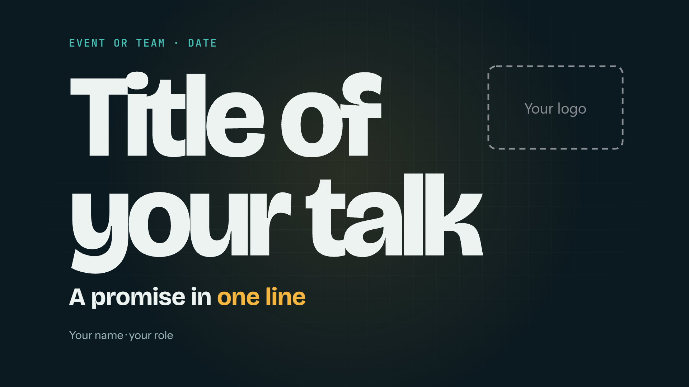

## 1. Start

1. Open `Presentation.html` in **Chrome or Edge**. Double-click it, or drag it into the browser.
2. Press **F** for full screen.

Keep the original safe. **Make a copy of the file for each talk** and work in the copy.

## 2. Present

| Key | What it does |
|---|---|
| → ↓ PageDown Space Enter | Next (animation step or slide) |
| ← ↑ PageUp Backspace | Back |
| Home / End | First / last slide |
| F | Full screen |
| B | Black screen (press again to return) |
| P | Presenter view |
| L | Spotlight: dark except a circle around the mouse |
| Z | Zoom around the mouse |
| + / − or mouse wheel | Bigger / smaller spotlight or zoom |
| D | Pen |
| H | Highlighter |
| X | Wipe the drawing on this slide |
| S | Settings |
| E | Editor |
| Esc | End spotlight and zoom; close the presenter view |

A presenter clicker works as it is: its Next and Back buttons move through the talk.

Back always shows the earlier slide **finished**, so no animation replays.

Drawings belong to their slide. They are never saved in the file.

The bar at the bottom has one segment per slide. Click a segment to jump there. The bar hides when the mouse is still.

| Spotlight | Zoom |
|---|---|
| 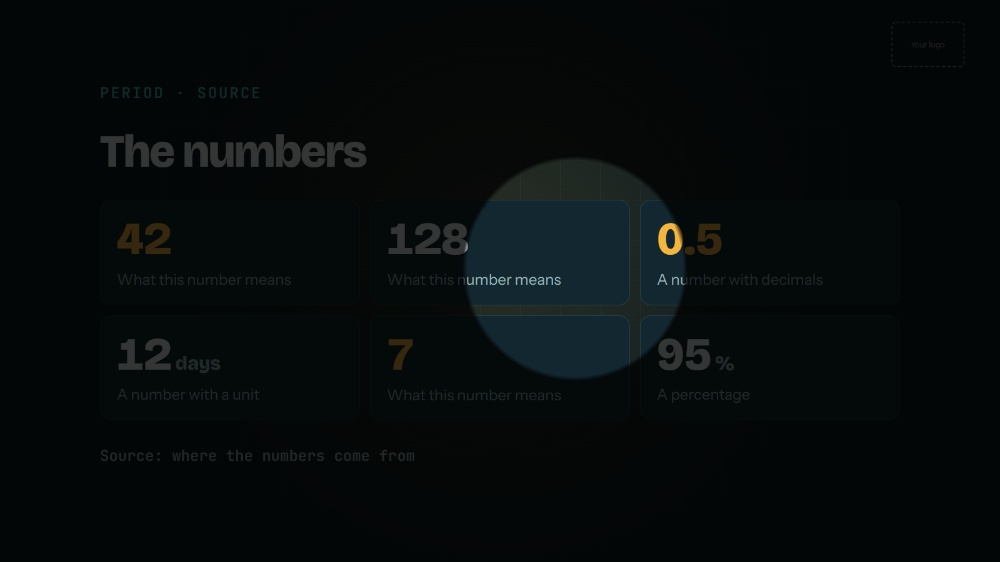 | 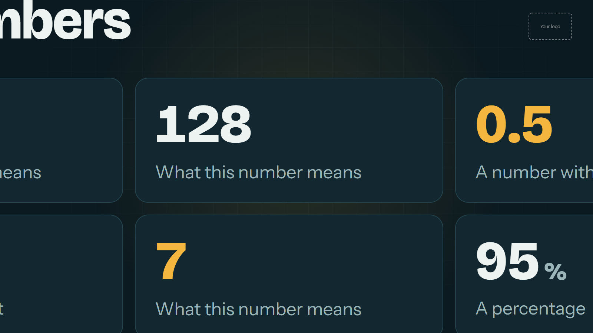 |

Some slides need extra clicks before they move on, for example the car on slide 7:

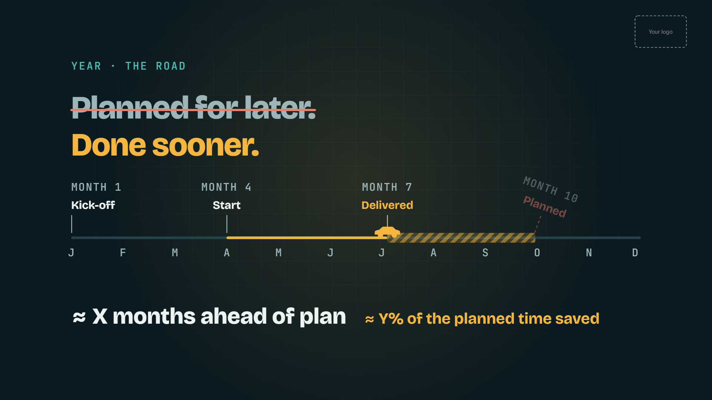

**Change a number while presenting.** Point at a counter, timer, gauge or poll: a small **− value +** bar appears. Click − or +, or click the value and type a new one. The effect starts again from its first click. The audience window follows. The file keeps its own number.

## 3. Presenter view

Use it with a projector. Set Windows to **Extend** these displays (Windows key + P). Then press **P**.

1. A second window opens. This is what the audience sees.
2. Drag it to the projector, or click **Move to projector**. Click in it and press **F**.
3. Present from the first window. The audience window follows every click.

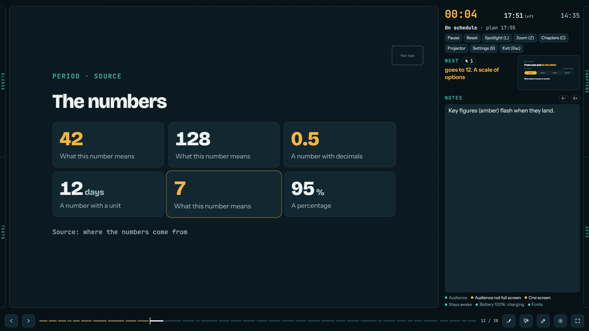

The presenter view shows:

| Part | What it shows |
|---|---|
| Timer | Time since your first Next. Click it to pause. **Reset** starts again |
| Countdown | The planned time left. Past zero it turns rose: *+00:40 over* |
| Clock | The time of day |
| Pace line | Ahead (teal), on schedule, behind (amber), far behind (rose) |
| Next | What the next click does, with a small preview |
| Notes | Your speaker notes. **A−** and **A+** change the size |
| Bottom bar | Each slide as wide as its planned time. A white marker shows where the plan says you should be |

Each slide has a planned time (see *Settings*). The chapter list shows the real time of finished slides.

A row of small dots at the bottom checks the audience window, full screen, second screen, battery and fonts. Teal is fine, amber is worth a look, rose is a problem. The checks never block anything.

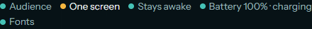

Four drawers hide at the edges. Point at a tab to open it, or press its key to keep it open.

| Key | Drawer | What it does |
|---|---|---|
| C | Chapters | Jump to a chapter; shows planned and real time |
| K or ? | Keys | Every key; the last key pressed (handy for a clicker) |
| G | Slides | All slides as pictures; click one to go there |
| T | Texts | Change the wording of the slides and the interface |

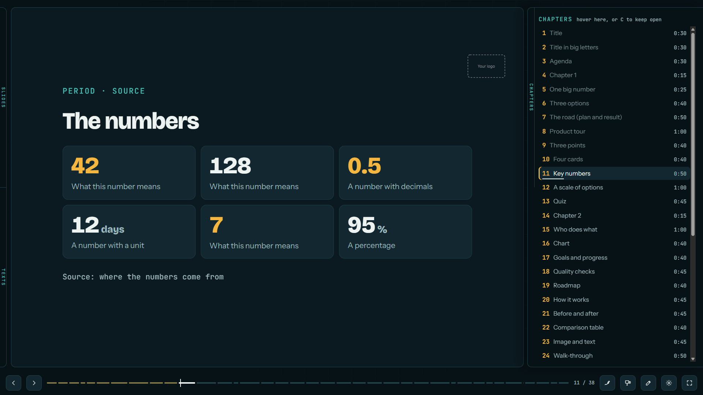

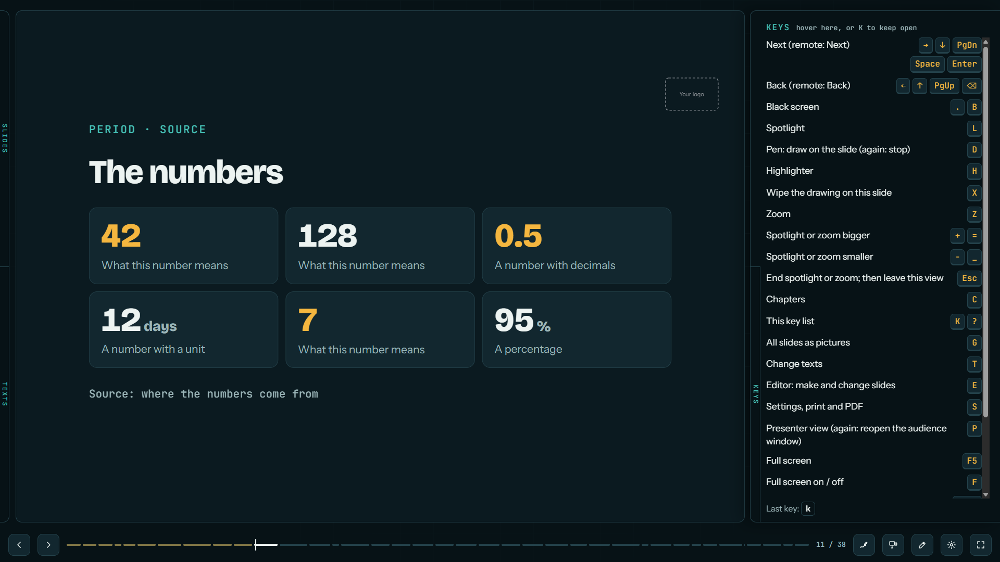

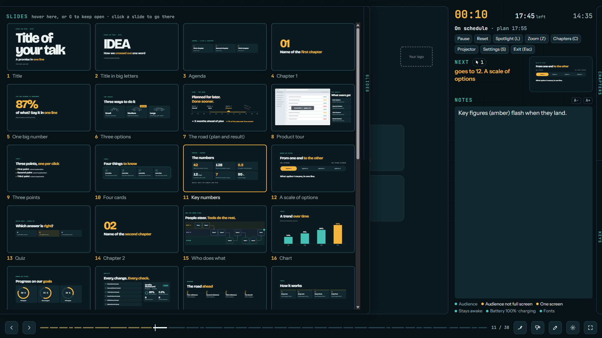

In the **Texts** drawer, type in a field and the slide changes at once, also on the projector. **↺** puts the original back. Changes stay in this browser. To keep them in the file, use **Save a copy** (see *Settings*).

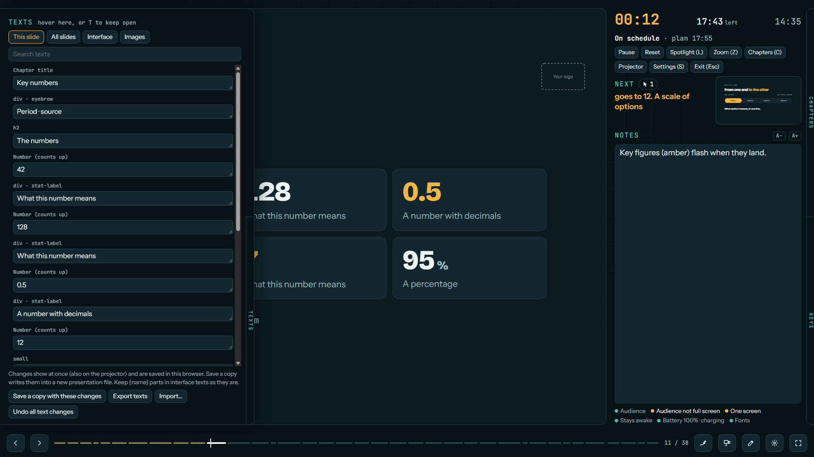

Backup slides for questions come after the last slide. Next never goes there. Open them from the Slides drawer or the chapter list.

## 4. Edit

Press **E** (or click the pencil button) to change the presentation in the file itself.

**The three areas**

| Area | What it holds |
|---|---|
| Left: slides list | Click a slide to edit it. Drag to reorder. **+ Slide**, **Duplicate**, **Delete**. **O** shows all slides large |
| Middle: the slide | Click a text and type. Click anything else to select it |
| Right: panel | Five tabs: **Element**, **Layers**, **Animations**, **Slide**, **All slides** |

The slides list and the panel hide at the edge. Point at their tab to open them. The pin button keeps one open.

**The panel tabs**

| Tab | Use it for |
|---|---|
| Element | Settings of the selected element: size, colour, how it appears |
| Layers | Every element of the slide as a list. Hide or lock elements |
| Animations | What appears or moves, in order |
| Slide | Chapter title, planned time, transition, notes, background |
| All slides | The theme, find and replace |

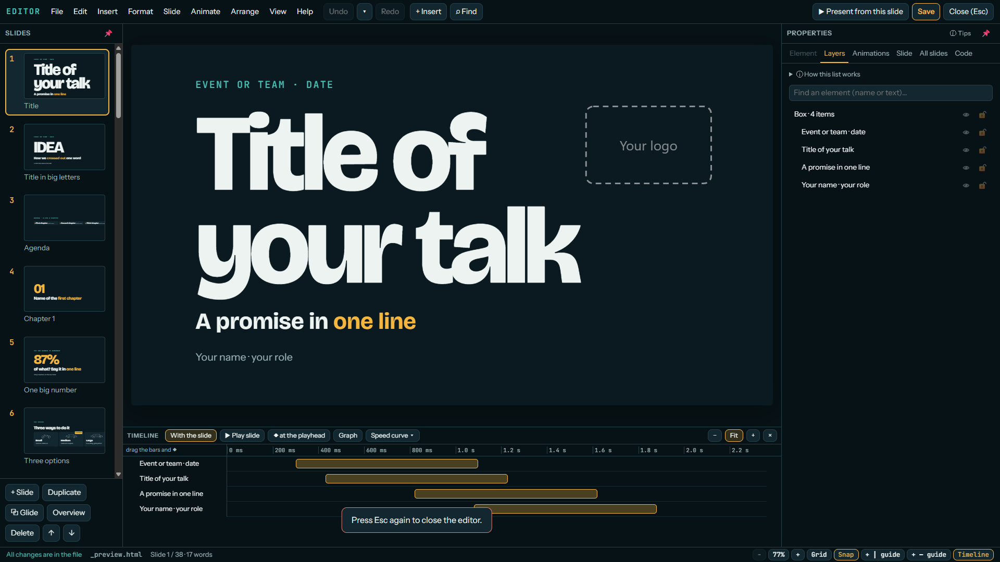

**Typing.** Click a text and type. **Enter** finishes. **Shift+Enter** starts a new line. Select words to get a small bar with bold, colour and link.

**+ Slide** opens the layouts: an empty slide or one of 70 slide templates. Tabs sort them: *Basics*, *Text*, *Numbers and charts*, *Diagrams*, *Compare*, *Pictures and mock-ups*, *Audience*, *Wow* and your own (*My layouts*). *All* shows every one. Many play an effect: rolling numbers, a gauge, a spinning wheel, a chat, a 3D cube, fireworks and more. Change their texts and numbers like any other text.

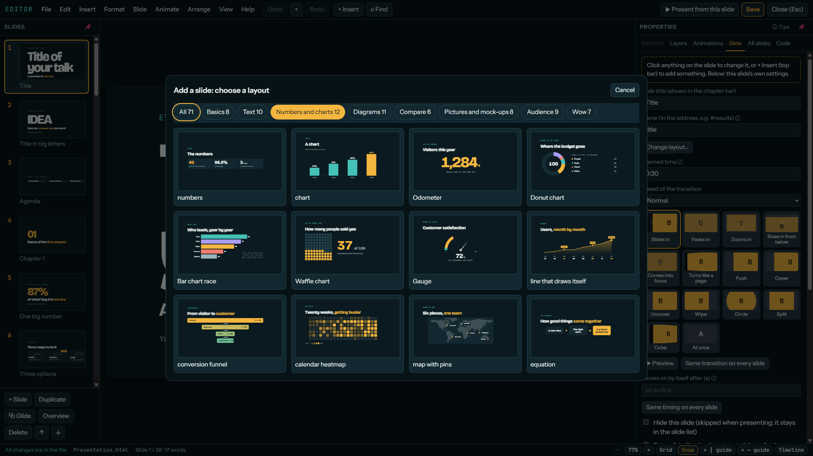

| Agenda | Chart |
|---|---|
| 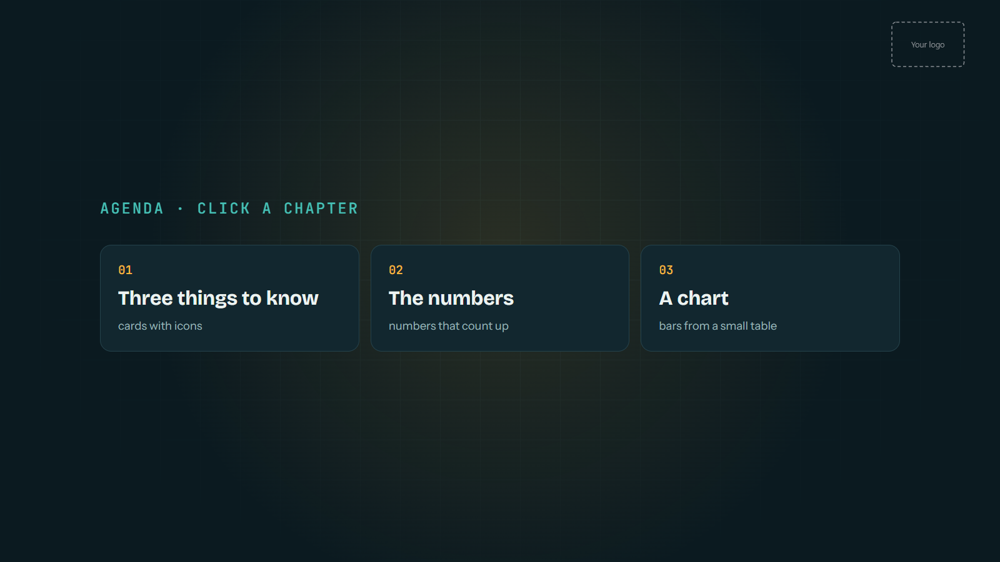 | 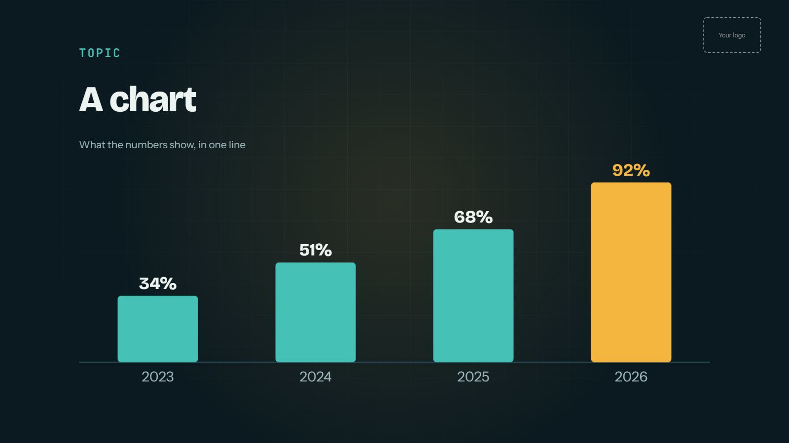 |

| Image | Process |
|---|---|
| 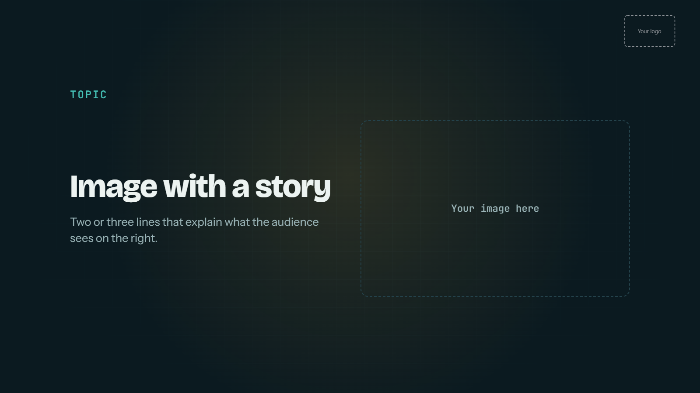 | 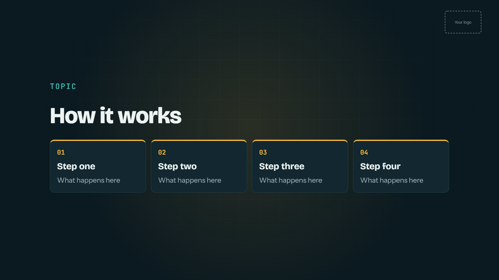 |

**+ Insert** adds a block: text, list, cards, numbers, chart, image, video, quote, QR code, break timer, or a shape.

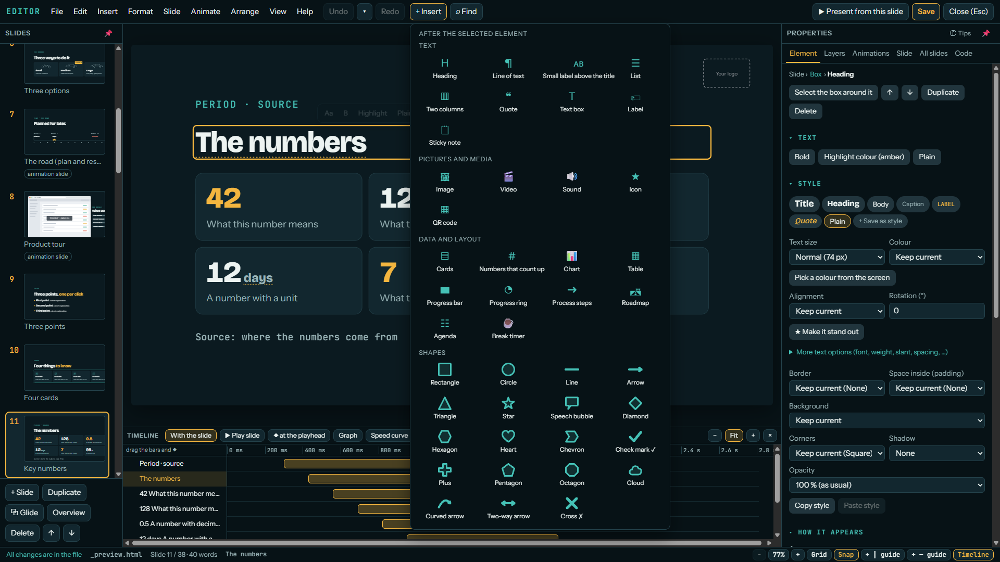

**Place freely.** Select an element and choose *Place freely* in the Element tab. Then drag it anywhere on its body. Eight handles resize it and the round handle turns it. It snaps to an 8 px grid and to other elements (red guide lines). Hold **Alt** while dragging to skip snapping. **G** shows the grid. Arrow keys move it 1 px (Shift: 10 px). Double-click an empty spot of the slide for a text box.

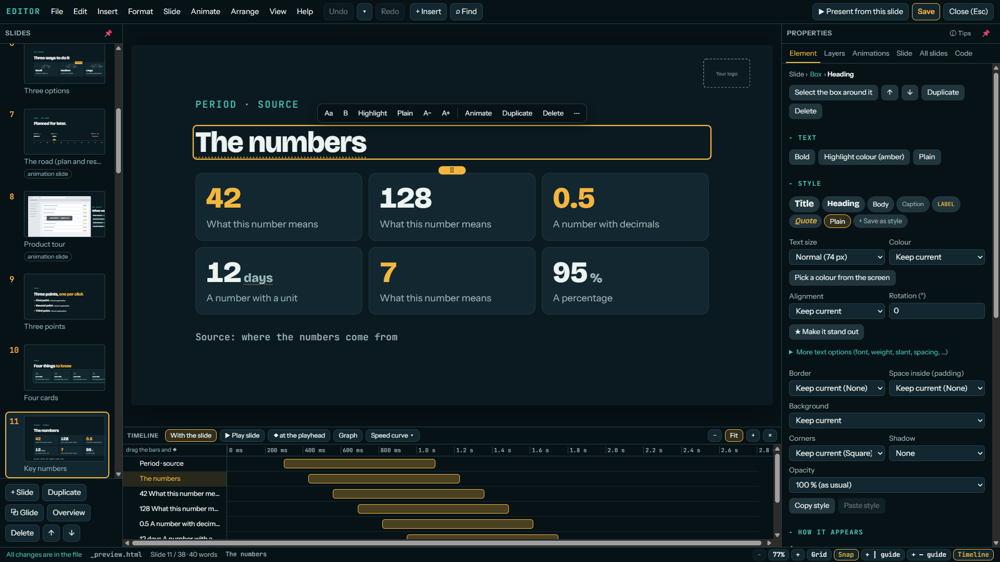

**Animations.** Pick an element and click **Animate** in its small bar for ready-made effects. Point at one to preview it. In the Element tab, *How it appears* sets "with the slide" or "on a click". The Animations tab lists everything in playing order. **▶ Play slide** shows it as in the talk.

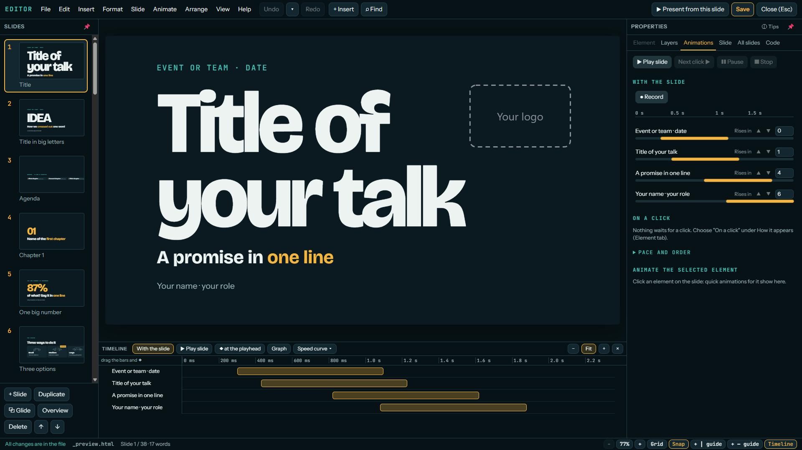

**The timeline.** Press **T** in the editor to open it under the slide. It has one row per element that appears or moves. Drag a bar to start it earlier or later. Drag its ends to change its length.

The **Slide** tab holds the chapter title, planned time, transition, notes and background.

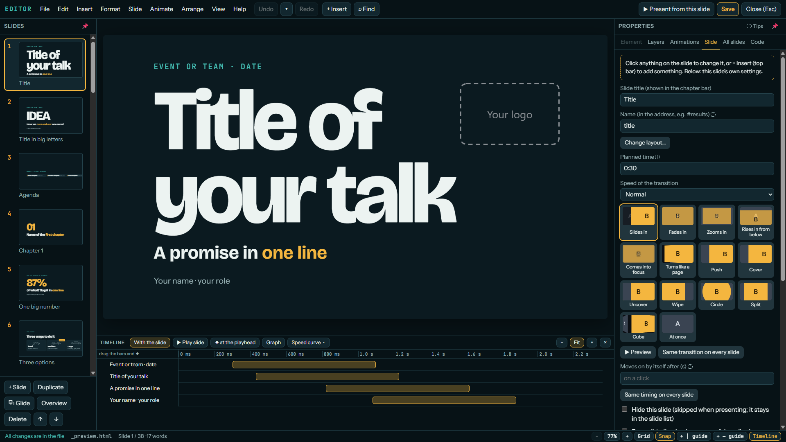

**Themes.** In the **All slides** tab, *Theme* shows every theme as a small slide. A click uses it for all slides.

**Save.** Press **Ctrl+S** to write into the same file. The first time, Chrome or Edge opens a window: pick **this same file** and allow it to be replaced. In other browsers Save downloads the file. Until you save, a draft is kept in the browser.

**Undo.** Ctrl+Z undoes. Ctrl+Y redoes. The arrow next to Undo lists the last changes.

**Find anything.** Press **Ctrl+K** and type a few letters of what you want, for example *new slide* or *border*. **?** shows all editor keys.

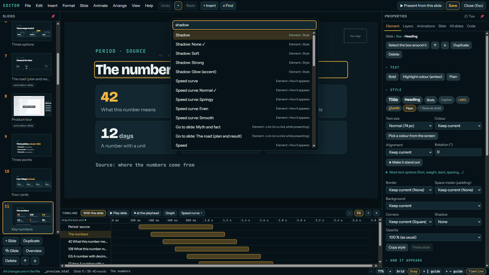

The **File** menu has Save, *Export without editor…* and Print.

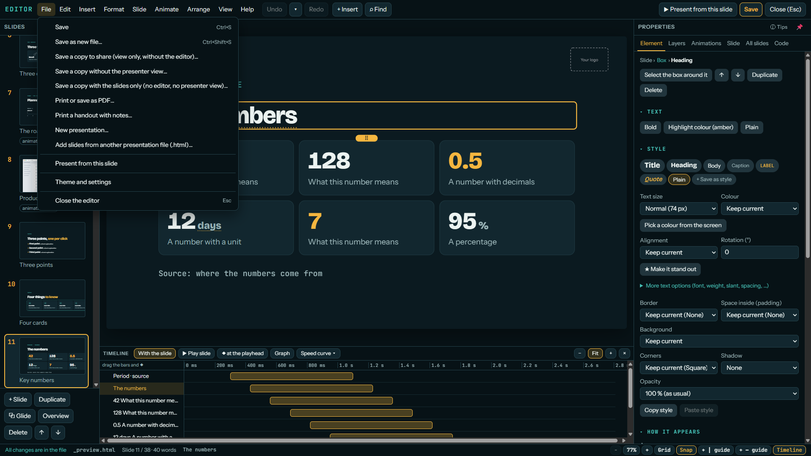

The editor does not open while the audience window is open. Close it first.

## 5. Pictures and video

- **Replace an image:** select it and click **Replace the image…**. Or drag a file from Windows Explorer onto it.
- **New image:** drag a picture file onto the slide. It becomes an image block. A pasted screenshot works too.
- **Video:** select it and click **Replace the video…**. It can play with the slide or on a click.
- **Without the editor:** in the presenter view, drag an image file onto an image of the large slide. Or open the Texts drawer (T), tab **Images**, and click **Replace…**.

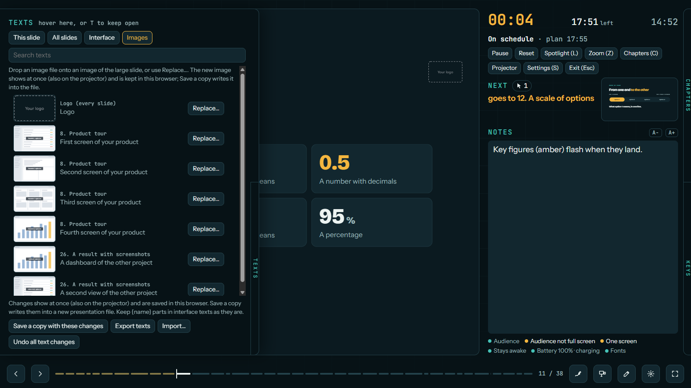

Pictures you swap in the presenter view stay in this browser. **Save a copy** puts them in a new file.

## 6. Settings

Press **S**, click the gear, or click **Settings** in the presenter view.

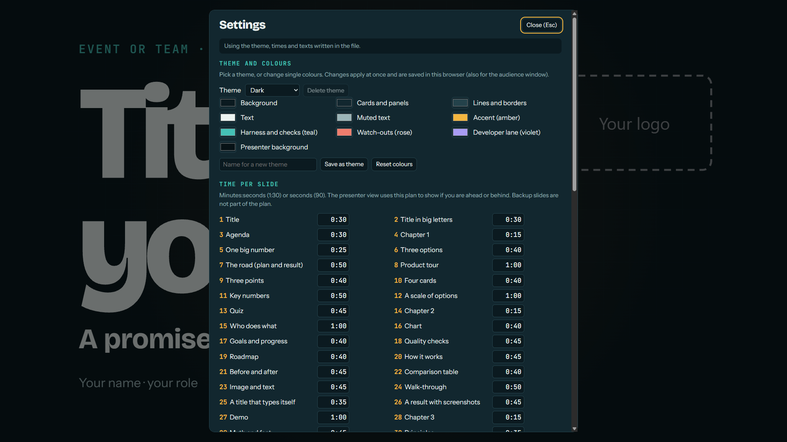

| Setting | What it does |
|---|---|
| Theme | Dark, Light, High contrast, Editorial, Swiss, Boardroom, Studio, Forest, Nocturne, Launch |
| Colours | Change single colours. **Save as theme** keeps them |
| Time per slide | Type `1:30` or `90`. The total shows under the list |
| Spotlight | Circle size and darkness |
| Save a copy with these settings | A new file with your theme, times and texts written into it |

| Light | High contrast |
|---|---|
| 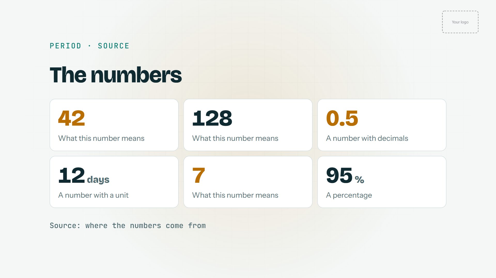 | 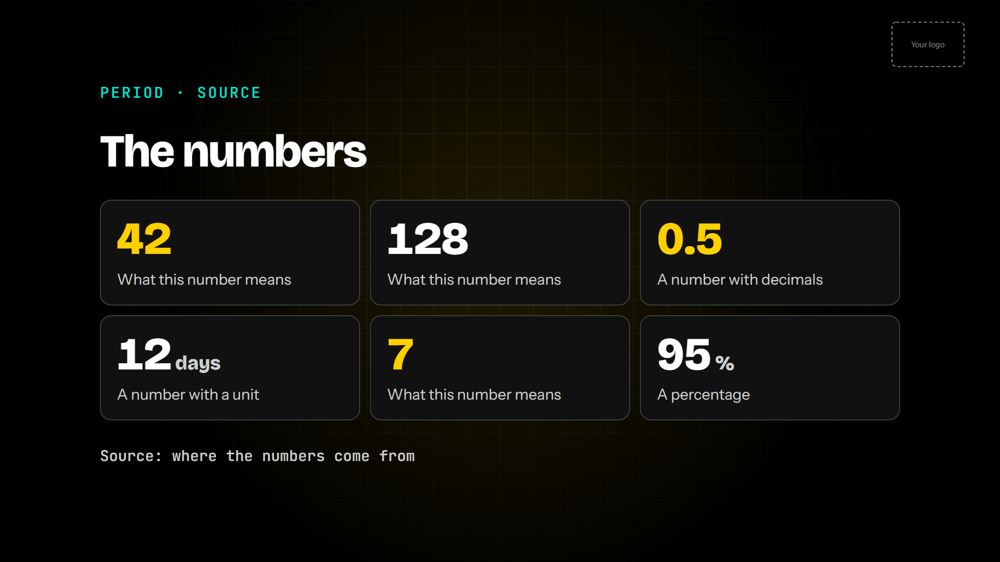 |

**Export and import** are at the bottom of the panel.

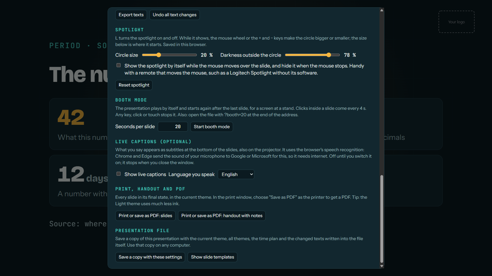

| Button | What you get |
|---|---|
| Export time plan | The planned seconds per slide |
| Export realized times | Planned and real time per slide (opens in Excel) |
| Export theme / Export texts | Your colours / every text |
| Import a file… | Reads any of these files back |
| Use realized times as plan | Your rehearsal times become the plan |

Real times are measured by the presenter view, so rehearse with **P** first. They live only in that window: **export them before you close it**.

**A good routine:**

1. Rehearse with the presenter view.
2. Click **Use realized times as plan**.
3. Pick a theme for the room.
4. Click **Save a copy with these settings** and present from that copy.

| Light theme | High contrast theme |
|---|---|
|  |  |

## 7. Print and PDF

In Settings, under **Print, handout and PDF**:

| Button | Result |
|---|---|
| Slides | One slide per page, landscape |
| Handout with notes | One slide per page with its notes below, portrait |

In the print window, choose **Save as PDF** as the printer. Leave *Background graphics* on. Every slide prints finished. Tip: the Light theme saves ink.

| Handout page | Slides page |
|---|---|
| 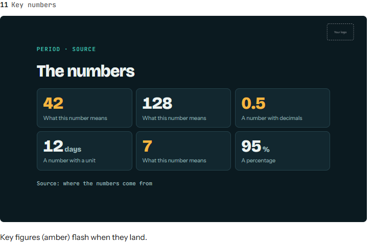 | 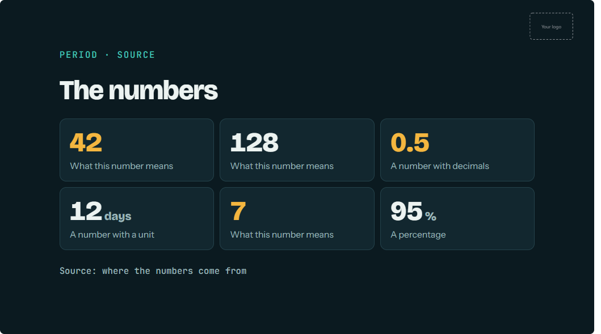 |

| Handout page | Slides page |
|---|---|
|  |  |

## 8. Share a copy without the editor

In the editor, open **File › Export without editor…**. You get `<name>-presentation.html`. It keeps the presenter view and settings, but has no editor, and it is about a third smaller.

Give that file to others. Keep the file with the editor for yourself.

## 9. Tips and good to know

- Everything works offline. The fonts and images are inside the file.
- Settings are saved **in this browser, on this computer**. To use them elsewhere, use **Save a copy with these settings**, or export and import.
- Add `?templates=1` to the address (`Presentation.html?templates=1`) to see the hidden slide templates after the last slide.
- For a screen at a stand, add `?booth=20`. The talk plays by itself, 20 seconds per slide, and starts again at the end. Any key, click or touch stops it. You can also start it in Settings under **Booth mode**.
- The screen does not dim or lock while the presentation is open.
- If Windows has animation effects turned off, press **M** to turn them on.
- If a slide's script fails, Next and Back still work.
- Live captions (Settings) send your microphone sound to Google or Microsoft. Do not use them for confidential talks.
